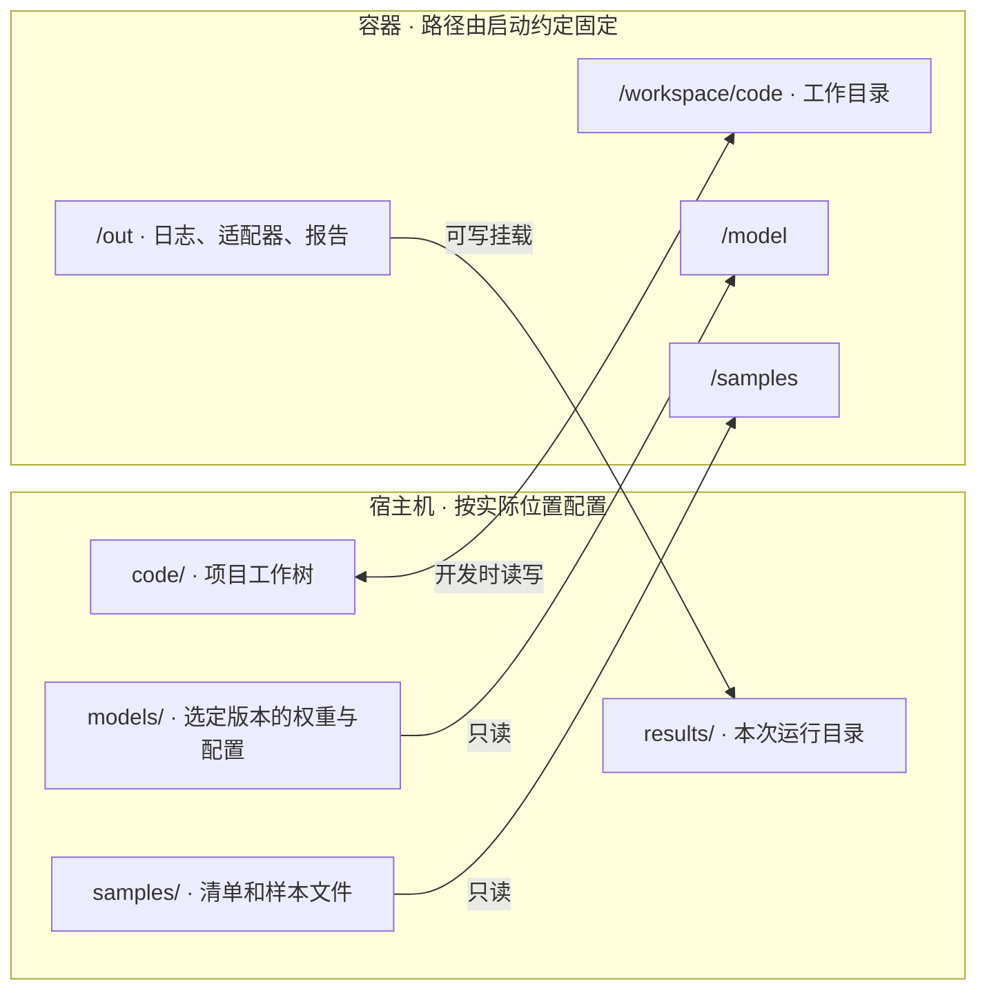

# 1 模型容器分阶段构建与迁移实操

这套流程用于把候选软件环境变成可在另一台机器上运行的模型任务。先验证基础镜像，再依次接入推理、微调或性能分析能力。每项能力通过后，将有效配置整理为可重建的镜像，并约定目标机器如何提供源码、权重、数据和 GPU。选型依据与训练验收标准见 [[01_Knowledge/模型/方法与流程/模型训练与环境固化流程]]。

## 1.1 检查基础镜像，再决定依赖装在哪里

先确定最终运行任务的 CPU 架构、GPU、驱动和容器运行支持，再选择能提供所需框架及计算库的基础镜像。拉取后记录平台和摘要，进入容器检查实际使用的 Python 解释器、框架版本与安装位置。需要编译扩展或采集性能指标时，一并检查编译器或分析工具。随后用指定 GPU 完成一次符合目标精度的基础运算，为后续模型测试建立起点。

先在**基础镜像内**检查默认解释器。需要决定的是，项目依赖应装进当前环境，还是先选择另一个环境。下面的命令只读取环境信息，可以在安装任何新包之前执行。

```bash
# 确认当前 Python 路径、是否运行于 venv，以及标准库是否带发行版管理标记。
python - <<'PYTHON'
from pathlib import Path
import sys
import sysconfig

print("python:", sys.executable)
print("in_venv:", sys.prefix != sys.base_prefix)
print("managed_marker:", (Path(sysconfig.get_path("stdlib")) / "EXTERNALLY-MANAGED").is_file())
PYTHON

# 查找可复用的候选环境：列出 Conda 环境，并在常见位置查找 venv 的标记文件。
if command -v conda >/dev/null; then conda env list; fi
find /opt /usr/local -name pyvenv.cfg -print 2>/dev/null
```

若候选环境能加载目标框架，且适合安装项目包，就选用该解释器。若默认 Python 位于 venv 外、带有发行版管理标记，又没有合适的现成环境，则创建项目 venv。需要复用基础镜像的 PyTorch 时，可用 `python -m venv --system-site-packages /opt/venv` 创建环境，再用 `/opt/venv/bin/python` 重做框架查询。预期结果是解释器来自新 venv，而框架路径和版本与创建前一致。

## 1.2 按任务增加依赖，并逐项取得运行证据

先构建最小推理环境，固定直接依赖，并为必须复用的框架和共享包设置版本约束。共享基础包的虚拟环境也会看到原有包的依赖要求。遇到冲突时，查清哪两个包对同一依赖提出了不同范围，结合项目需要调整约束或上游版本，再检查最终环境的依赖一致性。保留通过验证的候选版本，下一次只增加当前任务所需的能力。

在安装项目依赖后，用同一个解释器检查包声明。随后在已分配 GPU 的容器内执行一次运算，把包兼容性和设备执行分开验收。

```bash
# 检测可见包的声明依赖是否一致。通过时退出码为 0。
python -m pip check

# 检测 CUDA 分配、矩阵乘法及结果回读。此例应得到 16.0。
python -c 'import torch; x = torch.ones((16, 16), device="cuda"); assert (x @ x)[0, 0].item() == 16.0'
```

按实际启用的能力选择验证内容。小规模测试的价值在于用低成本确认执行链路，每项检查应有可观察的通过条件。

| 能力 | 怎样验证 | 通过条件 |
|---|---|---|
| 推理 | 固定模型和一条有参考结果的真实样本，经过预处理、加载、前向或生成 | 成功产生输出；分别记录输出结构和语义是否满足任务要求 |
| 参数高效微调 | 指定可训练模块，执行一次反向传播和优化更新，保存适配器，再加载到重新初始化的同一基座版本 | 目标参数确有更新，保存和重载结果一致 |
| 性能分析 | 先确认工具可启动，再在一个已知 GPU 工作区间内采集硬件指标 | 报告可读，含预期 kernel 与所需指标；权限不足时记录运行前提 |
| 可选加速后端 | 在同一输入上检查实际生效的实现，复验输出，再独立运行基准测试 | 后端、质量变化与端到端性能均有对应记录 |

## 1.3 将验证过的阶段收敛为一个交付版本

开发时分阶段检查，可以快速定位哪组依赖引入了问题。确定交付范围后，把通过验证的安装方式、系统包、Python 依赖及构建条件收敛到一份最终 Dockerfile。基础镜像用摘要标识，项目直接依赖和实际解析出的间接依赖分别记录；如果安装系统组件还更新了已有包，也应保存对应的软件包版本。要求离线恢复时，提前准备安装包及其来源。

最终维护一个验收入口，按运行条件选择检查。**构建时**执行解释器与框架身份、依赖一致性、关键接口导入和工具版本检查。**运行时**由同一入口选择 GPU 运算、真实推理、微调或计数器采集；这些检查需要设备、外部输入或宿主机权限。将验收入口放进镜像，使接收方能够用相同方法复验。随后从锁定的输入进行干净重建，使用重建产物复跑相应检查。

## 1.4 设计容器目录和启动约定

目标机器除了镜像，还要获得一次运行所需的输入。在交付前确定代码、模型、数据、配置和输出分别由谁提供，并固定程序在容器内看到的位置。这样迁移时通常只需调整宿主机参数。

下图采用运行时挂载源码的方式。左侧是宿主机准备的目录，右侧是容器里程序使用的路径。箭头表示任务读取输入或写回结果的方向。



开发时把宿主机工作树读写挂载到容器，在容器里编辑源码或实验配置，修改会写回宿主机。服务器可以分别指定工作树的位置和容器内的代码路径；启动脚本用同一个容器路径设置源码挂载点、工作目录和相应的模块搜索路径。复现实验时，可将选定提交的工作树只读挂载。样本清单与其引用的文件作为一个目录挂载，以保留相对路径。若发布镜像已包含固定版本的源码，可直接使用镜像内的工作目录。每次运行使用独立的输出目录，同时保存生效配置，便于在容器退出后核对结果。

## 1.5 迁移到目标机器并验收

交付镜像时，可通过仓库按摘要拉取，或通过校验过的镜像归档传递。同时交付构建与依赖记录、启动脚本、外部输入的版本和准备方式，以及已通过的测试范围。目标机先核对镜像身份和挂载，再用同一验收入口复跑基础运算、真实样本和所需任务。若性能分析是迁移目的，应尽早验证计数器权限，以便决定能否开始模型级采集。

例如，迁移目的是用 Nsight Compute 分析模型热点。目标机上先对一次已知的 GPU 加法采集计数器。如果工具能启动，却在读取计数器时报权限错误，应先解决目标机的采集权限，再用同一小负载确认报告中有该 kernel 的指标。通过这一步，再启动耗时更长的模型分析。

基本链路通过后，换成正式模型、数据规模和目标配置，分别验收任务质量、显存与吞吐或延迟。硬件计数器用于解释热点，整体收益由独立基准测试确认。把结果关联到镜像、代码、输入和宿主机条件，接收方就能区分已经验证的能力，以及更换模型、硬件或后端后需要重新测量的部分。
