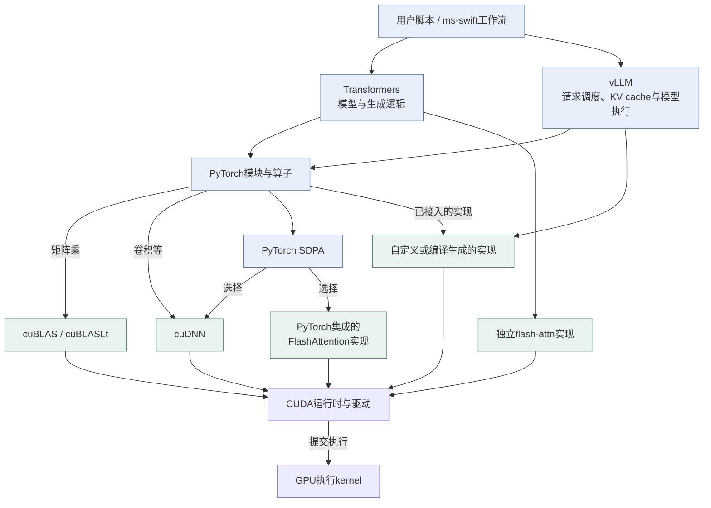
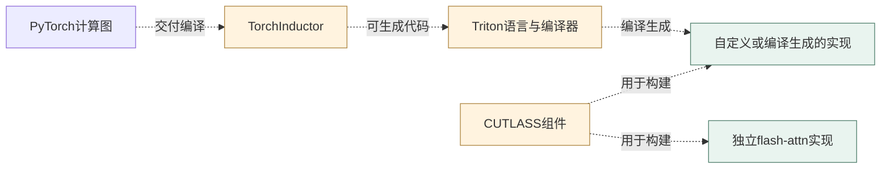

# 1 模型软件栈与框架分工

运行同一个图文模型，可以直接写Transformers脚本，也可以用ms-swift启动推理，或交给vLLM提供服务。它们都可能使用PyTorch Tensor，并最终启动GPU kernel，但各自控制的过程不同。理解这些职责，才能判断一个配置改变了什么，以及性能变化应该在哪里验证。

本篇作为P02A的软件视角入口，按“工作流由谁组织 → 模型由谁实现 → 请求由谁调度 → 算子由谁执行”展开。需要理解block、warp、SM或计算与访存机制时，接着阅读[[02_Projects/AI-Career-Transition/10_学习文档/P02A-01_VLM模型工程认知_学习文档]]第1.3～1.6节。实验数据和个人学习进度分别由实践记录与学习记录承载。

## 1.1 先识别职责，再理解依赖

“使用了PyTorch”说明系统共享某些基础能力，还需要继续问它如何组织这些能力。工作流框架负责把数据、模型和执行入口接起来，模型库定义网络结构和输入输出，推理引擎管理请求及缓存，计算实现则决定某项运算怎样在设备上完成。

| 对象 | 主要职责 | 使用者通常控制什么 |
|---|---|---|
| ms-swift | 整合模型适配、数据模板、微调、推理、评估与部署流程 | 数据、微调方式、模型、推理引擎和运行参数 |
| Transformers | 提供模型实现、配置和权重加载、tokenizer/processor、生成及训练相关接口 | 模型forward、输入处理、生成策略及模型支持的attention后端 |
| vLLM | 提供离线和在线推理引擎，组织请求调度、KV cache及模型执行 | 并发、token预算、缓存、并行和支持的执行后端 |
| PyTorch | 提供Tensor、自动求导、nn.Module、算子分派、编译及设备执行基础 | 张量运算、梯度、设备、dtype和执行模式 |
| PyTorch SDPA | 提供scaled dot-product attention接口，并选择可用的计算实现 | Q/K/V、mask、causal、dropout及后端选择条件 |
| FlashAttention-2 / flash-attn | 提供优化attention算法的实现和GPU kernel，支持相应的定长或变长接口 | 受支持的dtype、形状、序列边界和调用参数 |

这张表按主要职责定位。Transformers也提供Trainer，ms-swift也有模型适配代码，vLLM也包含模型实现和计算kernel。因此，一个软件项目可以跨越几层，分析时应定位当前使用的组件。[ms-swift参数说明](https://swift.readthedocs.io/en/latest/Instruction/Command-line-parameters.html)、[vLLM架构](https://docs.vllm.ai/en/latest/design/arch_overview/)

## 1.2 一次训练或推理如何穿过这些层

以ms-swift为入口做微调，用户配置会决定数据与模板、可训练参数及训练方式。执行过程需要模型完成forward，由自动求导计算梯度，再由训练循环组织参数更新和checkpoint保存。ms-swift把这些任务接成工作流，模型内部依然需要具体的张量运算实现。训练后端和并行方式会进一步改变执行组织。

同样从ms-swift启动推理时，infer_backend决定交给哪个引擎执行。选择Transformers路径，可以由其生成逻辑驱动模型逐步生成；选择vLLM路径，则由推理引擎组织请求、缓存和执行。这解释了为什么统一命令入口仍可能对应不同的性能与行为边界。[ms-swift推理与部署](https://swift.readthedocs.io/en/v3.10/Instruction/Inference-and-deployment.html)

下面两张图分别回答“运行时调用谁”和“计算实现怎样构建”。绿色节点表示可被调用的计算库或实现，两张图中同名节点对应同一个角色。图中展示有代表性的路径，具体选择由版本、模型和配置决定。

**运行时调用：沿实线从上向下阅读。** 蓝色节点组织模型执行与算子选择，绿色节点提供具体计算，最后通过CUDA运行时与驱动提交到GPU。SDPA在图中展开FlashAttention和cuDNN两类候选，接口与实现的区别见第1.3节。



**构建与编译：沿虚线从左向右阅读。** 橙色节点是构建工具，右侧绿色节点是接入上图的计算实现。TorchInductor可以生成Triton代码，再由Triton编译；CUTLASS组件可用于构建自定义实现，也被flash-attn v2.8.3的CUDA实现使用。



同一模型可以同时调用现成计算库和编译生成的实现。即时编译也可能发生在程序运行期间，因此实线与虚线区分的是执行计算和生成实现两种职责，而不是两个互不重叠的时间段。构建工具及版本案例的依据见第1.3.1～1.3.2节。

vLLM可复用Transformers生态的配置、tokenizer和processor，也可在受支持的路径中使用Transformers模型实现。分析实际运行时，要继续核对执行引擎选用的是哪种模型实现。[vLLM架构](https://docs.vllm.ai/en/latest/design/arch_overview/)、[Transformers模型后端](https://huggingface.co/docs/transformers/main/en/transformers_as_backend)

因此，“对torch不同层次的封装”可以帮助理解上层接口简化，但完整关系还包括扩展与执行替换。例如flash-attn接收PyTorch Tensor，通过扩展调用优化kernel。Tensor仍属于PyTorch生态，运算细节由该实现承担。

## 1.3 算法、接口、实现与后端如何对应

以attention为例，scaled dot-product attention描述一项数学运算。PyTorch的scaled_dot_product_attention是实现这项运算的公共入口，通常简称SDPA。调用该入口后，框架还要根据输入和运行条件选择可用实现。

FlashAttention描述attention的高效计算方法，FlashAttention-2进一步优化其执行组织。独立软件包flash-attn提供相应接口和kernel实现。PyTorch SDPA也可以选择FlashAttention实现，所以“SDPA路径出现FlashAttention kernel”是正常的调用关系。[PyTorch SDPA接口](https://docs.pytorch.org/docs/main/generated/torch.nn.functional.scaled_dot_product_attention.html)、[FlashAttention项目](https://github.com/Dao-AILab/flash-attention)

在Transformers中，attn_implementation选择模型调用的attention后端。设置sdpa时进入PyTorch SDPA接口；设置flash_attention_2时进入对应的FlashAttention集成路径。两个名称处于这个配置接口的同一选择位置，但被选择的软件内部职责和分派过程不同。[Transformers attention后端](https://huggingface.co/docs/transformers/v5.2.0/en/attention_interface)

“后端”始终相对于调用者使用。ms-swift的推理后端可以是vLLM，Transformers的attention后端可以是SDPA，而SDPA自身还可以选择底层attention实现。阅读配置时，先确定是谁读取这个字段，再判断它能改变多大范围。

### 1.3.1 PyTorch怎样使用计算库和实现工具

沿着前面的调用关系继续向下，PyTorch需要把矩阵乘、卷积或attention交给具体实现。这里有两种常见方式：调用已经提供计算接口的库，或者使用开发工具生成适合该运算的代码。cuBLAS、cuDNN主要帮助调用者完成前一种工作；CUTLASS、Triton主要帮助实现者完成后一种工作。

| 对象 | 在软件栈中的位置 | 与PyTorch的关系 |
|---|---|---|
| cuBLAS | NVIDIA提供的GPU线性代数库，包含矩阵乘等运算；cuBLASLt提供更灵活的矩阵乘接口 | PyTorch的CUDA矩阵乘可调用这些库，由库选择并执行相应实现 |
| cuDNN | NVIDIA提供的深度学习计算库，覆盖卷积、归一化、attention等运算 | PyTorch可把受支持的运算交给cuDNN；SDPA也有cuDNN执行路径 |
| CUTLASS | 用于构建高性能GPU计算实现的组件与抽象，经典形式是CUDA C++模板，也提供Python DSL | 框架或扩展开发者可用它构建计算实现，再接入PyTorch；使用者往往通过上层算子间接使用 |
| Triton | 面向并行计算的语言与编译器，允许用Python风格代码描述GPU计算 | 开发者可以编写接收PyTorch Tensor的Triton实现；PyTorch的TorchInductor也可以生成Triton代码 |

cuBLAS和cuDNN都提供可供框架调用的计算能力，主要侧重点分别是线性代数和深度学习运算，两者覆盖范围有所交叉。CUTLASS和Triton则更接近实现者的工具箱，帮助开发者构建矩阵乘、attention或其他计算代码。它们本身具有独立的接口和编译机制，与PyTorch的关系是集成与协作。[cuBLAS介绍](https://docs.nvidia.com/cuda/cublas/index.html)、[cuDNN attention](https://docs.nvidia.com/deeplearning/cudnn/latest/operations/Attention.html)、[CUTLASS概览](https://docs.nvidia.com/cutlass/latest/overview.html)、[Triton介绍](https://triton-lang.org/)

以一个线性层为例，在常见CUDA执行路径中，`nn.Linear`的矩阵乘部分可经过PyTorch算子，调用cuBLAS或cuBLASLt，再启动GPU kernel。使用`torch.compile`并选择TorchInductor后，编译器还可以为适合的计算生成Triton代码。具体选择取决于运算、输入和编译配置；同一个模型可以同时使用库调用和生成代码。[PyTorch计算后端](https://docs.pytorch.org/docs/stable/backends.html)、[PyTorch编译机制](https://pytorch.org/get-started/pytorch-2-x/)

```text
运行时的一条常见路径：
模型的线性层 → PyTorch矩阵乘算子 → cuBLAS / cuBLASLt → GPU kernel

构建实现的两种方式：
开发者使用CUTLASS组件 → 编译成计算实现 → 由框架或扩展调用
开发者或TorchInductor生成Triton代码 → Triton编译 → 运行生成的GPU kernel
```

这几条箭头分别表示调用关系和代码生成过程。阅读软件依赖时，区分“运行时调用谁”与“实现是用什么工具构建的”，就能把这些名称放到合适的位置。这里的Triton指编程语言与编译器；NVIDIA Triton Inference Server是另一个用于模型服务的软件项目。

### 1.3.2 FlashAttention与这些工具如何协作

FlashAttention回答的是attention怎样高效计算，CUTLASS与Triton回答的是如何把计算方法写成可执行实现。因此，同一种FlashAttention算法可以有不同的实现工具和软件入口。独立flash-attn项目的v2.8.3 CUDA实现使用了CUTLASS/CuTe组件；Triton官方教程也提供FlashAttention v2算法的实现。两者说明算法与开发工具的关系，具体模型使用哪条路径仍由集成代码决定。[flash-attn版本源码](https://github.com/Dao-AILab/flash-attention/blob/v2.8.3/csrc/flash_attn/src/kernel_traits.h)、[Triton attention示例](https://triton-lang.org/main/getting-started/tutorials/06-fused-attention.html)

回到模型调用，可以把两条attention路径读成：

```text
模型attention → PyTorch SDPA → 所选实现（如FlashAttention或cuDNN）→ GPU kernel
模型attention → 独立flash-attn接口 → 该包提供的attention实现 → GPU kernel
```

第一条路径由PyTorch在受支持的候选实现间选择，第二条路径由模型集成进入独立软件包。cuDNN也提供attention计算，因此在PyTorch SDPA内部，它可以与其他attention实现成为同一选择位置的候选。[PyTorch后端控制](https://docs.pytorch.org/docs/stable/backends.html)

这也解释了性能报告里为何会同时出现不同层次的名称：`aten::mm`描述框架运算，cuBLAS描述提供计算能力的库，CUTLASS或Triton线索可能描述实现的构建来源。看到这些名称后，应沿调用关系识别运算归属；切换模型的attention后端，主要改变受该配置控制的attention路径，线性投影的矩阵乘继续由自己的执行路径承担。

## 1.4 用视觉后端切换理解配置边界

多模态模型通常包含视觉和语言子模型。Transformers支持按子配置名分别指定attention实现。以下字典明确选择视觉FlashAttention-2和语言SDPA，两个键对应模型内部配置对象。

```json
{
  "vision_config": "flash_attention_2",
  "text_config": "sdpa"
}
```

以Transformers 5.2.0的Qwen3.5视觉实现为例，`Qwen3_5VisionAttention.forward`先对拼接的视觉序列做QKV投影，再根据attention后端配置选择如何组织调用。下面比较的是这个模型版本的两条适配分支。

| 模型的attention后端配置 | Qwen3.5模型适配代码如何组织调用 |
|---|---|
| `sdpa` | 模型代码先按`cu_seqlens`拆分Q/K/V，再循环调用SDPA适配接口，最后拼接各段结果 |
| `flash_attention_2` | 模型代码通过变长attention接口一次提交拼接的Q/K/V及`cu_seqlens`，由该实现处理多段独立序列 |

拆分发生在进入SDPA之前，源码中的`torch.split`和逐段循环都位于模型的`forward`中。SDPA接口本身支持带batch维度的输入，每次调用内部也可以选择FlashAttention实现。因此，这个例子说明的是Qwen3.5如何适配两种后端；其他模型或版本可以采用不同的调用组织。[版本固定的视觉实现](https://github.com/huggingface/transformers/blob/v5.2.0/src/transformers/models/qwen3_5/modeling_qwen3_5.py#L915-L956)、[PyTorch 2.10 SDPA接口](https://docs.pytorch.org/docs/2.10/generated/torch.nn.functional.scaled_dot_product_attention.html)

变长路径中的`cu_seqlens`保存各段的累计边界，一次提交的不同图像序列仍具有各自的attention范围。接口调用次数、底层kernel启动次数和GPU并行程度需要分别观察。切换后端的收益可能同时来自调用组织、计算和访存效率，实际阶段耗时及整体吞吐由测量确定。

text_config控制语言侧受该配置管理的attention层。Qwen3.5的linear-attention层另有实现路径，MLP的矩阵乘法也由自身的执行路径承担。由此可以预测，这轮视觉后端对照应首先观察vision阶段，随后验证完整生成的吞吐、显存和输出质量。

## 1.5 从软件层级决定优化与验证范围

知道各层职责后，可以先用改动范围筛选证据。切换整个推理引擎时，请求调度、缓存和模型执行都可能变化，需要统一请求负载和生成合同。切换一个attention后端时，先确认模型分支和实际调用，再观察受影响阶段。改变数值精度时，还要把数值及任务质量回归纳入比较。

| 改动 | 首先核对 | 用什么结果决定是否采用 |
|---|---|---|
| ms-swift推理后端从Transformers切到vLLM | 模板、预处理、模型适配、生成参数、缓存与调度设置 | 同负载下的有效输出、吞吐、延迟和显存 |
| 只切换vision attention后端 | 实际vision/text配置、依赖版本、序列边界和执行路径 | vision时间与完整任务收益，另做质量回归 |
| 改变batch | 样本对应、padding、实际输入输出长度和容量 | 固定完整样本集合的重复吞吐及失败情况 |

可以用三个问题自检理解程度：使用ms-swift是否足以确定实际推理引擎？SDPA路径为何可能出现FlashAttention kernel？只切换vision后端时，哪些配置与指标需要核对？回答时应能指出调用者、选择位置和受影响的执行范围。
