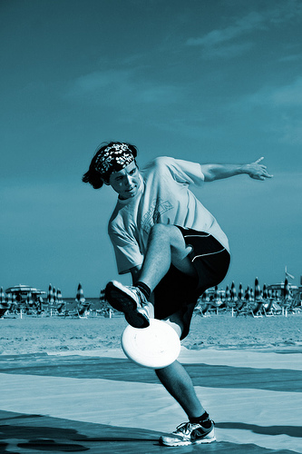
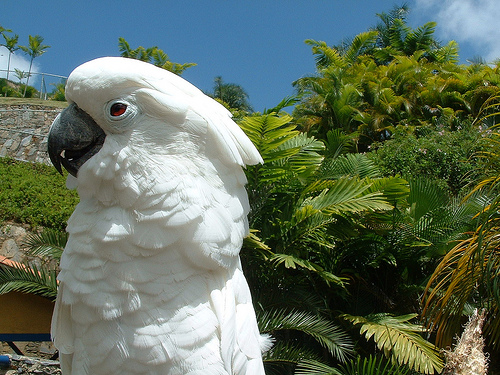
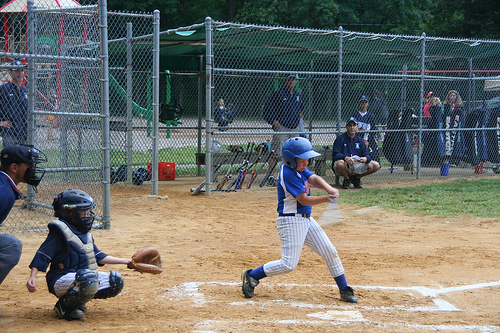
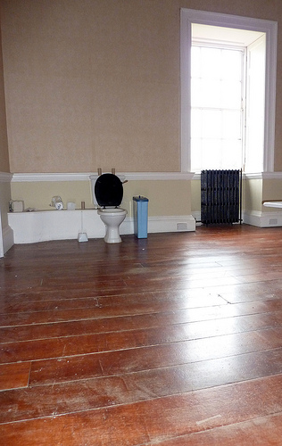
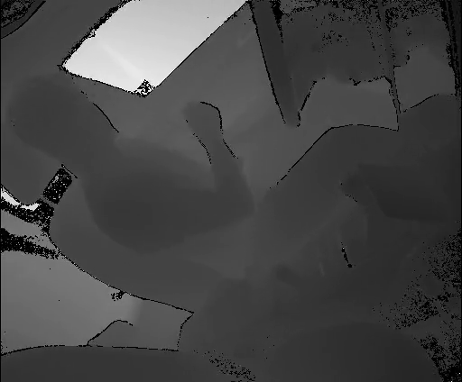
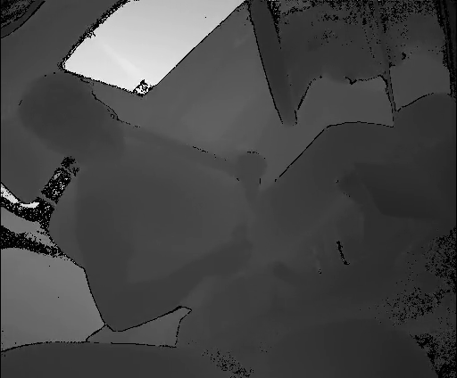

# 1 VLM 数据标注指南：按任务选择标什么、怎样标、怎样验收

给同一张公交车照片，可以布置三项标注工作。让人“描述这张图”，交付物是一句对画面的描述；让人“圈出带广告的车”，交付物是语言指向的车辆区域；让人“抄下广告文字”，交付物是文字区域及逐字转写。照片相同，但完成一项所需的标注，未必足够完成另一项。

**选任务先看下游怎样使用答案。** 若下游要确定位置，标签就得落到像素或区域；若要回答问题，标签要对应问题所问的事实；若要执行操作，还得记录行动的前提和结果。下面按这种区别组织常见任务族。同一个样本可以组合几类任务，例如读路牌并回答限速是多少，需要先识字，再定位所问的数值。

| 需要模型交付什么 | 去哪一节 | 可参考的数据集 |
|---|---|---|
| 类别、属性、全部实例及其区域 | 1.1 识别、检测与分割 | COCO、Visual Genome |
| 整图描述或局部描述 | 1.2 描述生成 | COCO Captions、Visual Genome、LLaVA |
| 一句话所指的对象、框或掩码 | 1.3 语言定位 | RefCOCO 系列 |
| 与文本匹配的图像，或与图像匹配的文本 | 1.4 图文匹配与检索 | Flickr30K、COCO Captions |
| 事实答案、数量、比较或关系推理结果 | 1.5 视觉问答与组合推理 | VQA v2、GQA、CLEVR |
| 转写文字、文档字段或图表计算结果 | 1.6 文字与版面理解 | TextOCR、TextVQA、DocVQA、ChartQA |
| 视频动作、事件区间、时序描述或预测 | 1.7 视频与驾驶场景 | Drive&Act、ActivityNet Captions、DriveLM |
| 一轮对话中的回答、澄清或无法判断 | 1.8 多轮交互 | Visual Dialog、SIMMC 2.1、VizWiz |
| 可执行的函数名、参数和任务结果 | 1.9 工具使用 | BFCL，作为工具标注的相邻领域参照 |

正文中带发布文件与样本 ID 的是数据集记录。“试标例”给的是自建数据可用的填写方式，各团队可按交付目标调整。**场景图、多人答案、教师生成**是生产或验证标签的方法。是否采用它们，在选定任务后再决定。

## 1.1 识别、检测与分割：先规定数哪些实例、画到哪里

问“这是一辆什么车”时，如果输入已裁成一辆车，每张裁剪图填一个类别即可；若输入是拥挤道路的整图，先给被判别的实例一个 ID，再把类别和属性挂到这个 ID 上。如果产品还要找出画面里的每辆车，就要对约定范围内的实例逐一标注。此时漏掉一辆会影响检测召回，也会让以后基于这张图生成的计数题少算一辆。

| 任务 | 标注单位与字段 | 交付前怎样查 |
|---|---|---|
| 整图分类／实例属性 | 图像或指定实例，加类别、所问属性、无法判断的原因。属性取值先约定粒度，例如 SUV 属于车身类别。 | 检查答案是否属于允许取值；局部任务另外查标签是否挂在正确实例上。 |
| 目标检测 | 每个范围内的实例一条记录，填类别、框、坐标约定；提前写明遮挡、截断、群体和忽略区域的处置。 | 分别检查漏标、重复框、类别和框的位置。检测任务可按类别和框的重叠程度匹配预测与真值。 |
| 语义／实例分割 | 语义分割给像素赋类别；实例分割还为相邻的同类物体保留各自的掩码和 ID。 | 两辆并排的车是有效反例：合成一个“车”区域可能保住类别像素，却丢失实例边界。 |

试标时先给标注员两张图，一张目标清晰，一张目标被挡半边。若两人分别画出“可见部分”和“估计完整轮廓”，应先修订边界定义，再批量开工。检测、实例分割与描述的发布格式可对照 [COCO 数据集](https://cocodataset.org/#download)。

## 1.2 描述生成：先指定描述范围，再规定哪些事实必须写

**整图描述**以图像为单位。标注员观察全图，用自然语言写下主要人物、物体和活动；多条描述可以选择不同细节。**区域描述**则以“区域＋文字”为单位。标注员先指明区域，再写属于该处的属性、动作或关系。若同一张图要产出多条局部描述，每句话都要保留到对应区域的引用。


图中左侧建筑外墙上有标牌。Visual Genome 图 1 的发布记录把短句和区域一起保存。下面的 x、y 是左上角，width、height 是宽、高。若删掉区域仍可读懂整句话，但就无法从记录判断这句话具体落在图中哪一处。

```json
{"region_id":1432,"image_id":1,"x":122,"y":14,"width":84,"height":178,"phrase":"A sign on the facade of the building"}
```

在 LLaVA 的图 442786 中，拿风筝和双腿交叉可用原图核对，“人们很开心”则涉及感受。图 215677 的腿下飞盘动作可以看图确认，如何练习平衡属于一般知识。若监督目标是忠实描述，审核这两类表达应采用不同依据。[LLaVA 指令集](https://huggingface.co/datasets/liuhaotian/LLaVA-Instruct-150K)

| 图 442786，详细描述 | 图 215677，推理问答 |
|---|---|
|  |  |

验收开放描述时，可以按事实拆句，检查对象、属性和关系有无冲突，再检查要求覆盖的事实是否遗漏。同义改写通常应被接受。对“描述仪表屏上全部告警”这种封闭任务，则需额外定义必须覆盖的告警集合，仅凭一段读起来自然的文字很难发现漏项。[COCO Captions](https://cocodataset.org/#captions-2015) · [Visual Genome 标注格式](https://visualgenome.org/api/v0/api_readme)

## 1.3 语言定位：让另一个人只凭这句话也能选中目标

在检测数据里，问题是“所有车在哪里”；在指代表达数据里，输入多了一句话，问题变成“这句话指哪一辆”。标注单位是**图像、表达、目标实例**。先选一个实例并绑定框或掩码，再写一句能在当前图中区分它的描述。复核者只看图和表达独立选对象，随后才揭示目标 ID。若“白色的车”有两个合理答案，应补充可见区分特征，或把样本保留为歧义任务。用掩码验收时还需复核边界是否正确。[RefCOCO、RefCOCO+、RefCOCOg 数据与 API](https://github.com/lichengunc/refer)

**空间关系怎样填？** 用上一节图中的标牌演示。发布关系 15930 的关键字段如下。把要定位的物体填在 subject，参照物填在 object，谓词 ON 按“前者位于后者上”回读。换一种提问方向时，这条有向关系仍保持原方向。

```json
{
  "relationship_id": 15930,
  "subject": {"object_id": 1058507, "name": "sign", "x": 118, "y": 13, "w": 88, "h": 182},
  "predicate": "ON",
  "object": {"object_id": 1058508, "name": "building", "x": 1, "y": 2, "w": 218, "h": 536}
}
```

查“标牌在什么物体上”可以得到 building；查“建筑上有什么”可以得到 sign。“外立面”这一更细的信息来自区域短句中的 facade。两份标注是在同图上按位置和语义核对的。若一栋建筑上有多个标牌，单用这条关系不足以唯一定位，应加另一项可见约束。

**迁移到“前面第二辆车是什么车型”。** 这是“先定位，再查属性”。试标例中，本车道由近及远为 v1、v2，左车道为 v3、v4。若上轮已明确本车道，标注员填 `scope=本车道，顺序=[v1,v2]，序号=2，目标=v2，所问属性=车身类别，值=SUV`。复核时独立重排候选，再检查 v2 的属性。按画面左右排序不能推出道路上的远近；车道或前后次序缺少依据时，要显式记录。若目标只交付自然语言答案，这组中间字段可留给生成和质检。

## 1.4 图文匹配与检索：标的是哪两条记录相配

检索系统接收一句话，要从一组图片中找出匹配项。标注员先建立图片 ID 与描述 ID 的正例对应，再检查候选集合中还有没有其他合理匹配。同一张图的多条人工描述可形成多个正例。若任务测的是二元匹配，还要给每对图文标“符合／不符合”；若训练使用采样负例，保存负例来源，抽查其中可能同样正确的配对。[Flickr30K 数据与描述](https://shannon.cs.illinois.edu/DenotationGraph/) · [COCO Captions](https://cocodataset.org/#captions-2015)

试标例：查询“一个人拿着风筝站在广场上”。广场风筝图可作正例。若候选里还有另一张同样满足描述的照片，仅因它来自别的图像 ID 就标负，会惩罚正确匹配。反过来，选一张“广场里有人但没有风筝”的图作经核实的负例，可以检查模型是否利用了“风筝”这个条件。检索验收可看前 K 项是否命中已标正例，并在解释分数时说明正例覆盖范围。

## 1.5 视觉问答与组合推理：由问题决定需要哪些底层标签

| 问题类别 | 建议怎样标 | 用什么反例验收 |
|---|---|---|
| 存在、类别、属性 | 填图像、问题、答案；需要定位诊断时增加指代对象。对否定答案规定可见范围。 | 同一问题换图后答案改变；遮挡导致看不清时不能自动标“不存在”。 |
| 计数、比较、排序 | 写清统计范围、单位及去重规则。用参与计算的实例列表生成数量；比较题保存双方集合，排序题保存参照系。 | 加入一个范围外实例，答案应维持；在范围内增减实例，重新计算答案。 |
| 关系与多步查询 | 保存支持答案的对象与关系；若要按规则大量出题，保存筛选顺序与计算程序。 | 对调主语和参照物、改变一个属性，检查派生答案是否应变。 |
| 开放式短答 | 保存可接受回答或多位标注员的原始回答，明确归一化与评分规则。 | 比较近义表达、上下位词和真正指错物体分别会得几分。 |

**需要程序求解的例子。** GQA 图 1339 的题 14778715 问“米饭左侧的餐具下面有没有餐巾”。先找到数据中标为 rice 的对象 1066932，再找位于其左侧的餐具 1066923，最后检查餐巾 1066926 是否有指向餐具的 under 关系。存在符合条件的对象，所以答 yes。只找出“米饭、餐具、餐巾”三个词，无法保证关系方向正确。CLEVR 则提供合成场景及程序，可研究目标筛选、计数、比较等操作的组合。[GQA 数据与场景图](https://cs.stanford.edu/people/dorarad/gqa/download.html) · [CLEVR](https://cs.stanford.edu/people/jcjohns/clevr/)


这三条 GQA 发布题分别展示类别、属性和整图问题所需的标注粒度。

| 图 2405722 · 问鸟的类别 | 图 2331963 · 问中间头盔的颜色 | 图 2400861 · 问室内还是室外 |
|---|---|---|
|  |  |  |
| 题 05515938：查对象 329774，答 parrot。 | 题 17197213：筛选位置、查 3205899，答 light blue。 | 题 08223573：查场景，答 indoors，无局部对象指针。 |

**需要多人答案的例子。** 下方左图验证题 262148002 问“他在什么东西上方”。十个回答是 picnic table 六票、table 三票、skateboard 一票。VQA v2 每次留出一人，在其余九人中计算匹配数，除以 3、上限为 1，再平均。预测 table 的得分为 (3 × 2/3 + 7 × 1)/10 = 0.9。预测 picnic table 得 1，skateboard 得 0.3。这套评分保留了共识，但同义表达也可能因用词频率不同而得分不同。[VQA v2 数据集](https://visualqa.org/download.html) · [官方评分](https://visualqa.org/evaluation.html)

| 图 262148 | 配对图 209757 |
|---|---|
|  |  |

对两图问“背景的人在做什么”，左图回答 watching 九票、spectating 一票，右图则是 skateboarding 七票、skating 三票。这组配对比单个正确答案更适合检查模型是否随画面改变判断。

## 1.6 OCR、文档和图表：区分抄写、找字段与计算

同一张单据可以产生三种样本。先问最终要交付的是**原文、指定字段，还是一个计算结果**。三者的评分依据不同。下表数字和短句是教学构造。

| 任务 | 标注员怎样填写 | 试标样例与验收 |
|---|---|---|
| 文字检测与识别 | 约定按词、行还是文本块分组，为文字区域画框或多边形，填原文、阅读方向和不可辨标记。 | 图片上印有 A07，就转写 A07。把 0 读成 O 是字符错；文字正确但框指向邻行是定位错。可分别评区域匹配和字符错误率。 |
| 场景文字／文档问答 | 保存问题、答案和页面或图像引用；需要可追溯时补答案区域、页码或文本跨度。现成 OCR 结果可作辅助输入，要和人工参考答案区分。 | 页面同时写有“开票日期”和“到期日期”。问到期日时，复核者须从正确字段取值。两个位置恰好同一天时，可用不同日期的对照页查错。 |
| 图表读取与数值推理 | 指明系列、横轴类别、单位和读数。若题目要求比较或相减，保存参与计算的值与运算，并约定舍入和误差容限。 | 图表 A、B 两列为 12 和 8 万辆。问“相差多少”得 4 万辆；问“A 比 B 高百分之几”得 50%。验收同时检查分母、单位和数值。 |

TextOCR 适合看词级文字区域和转写；TextVQA 适合看怎样把场景文字用于回答问题；原始单文档 DocVQA 任务要求答案是页面中的文本片段；ChartQA 把图表视觉信息与逻辑或数值推理结合。这些任务各有发布口径，上表中的复核字段供自建任务选择。[TextOCR](https://textvqa.org/textocr/dataset/) · [TextVQA](https://textvqa.org/download/) · [DocVQA](https://www.docvqa.org/datasets/docvqa) · [ChartQA](https://github.com/vis-nlp/ChartQA)

## 1.7 视频理解、时间定位与预测：标注员能看多久，模型能看多久

**动作分类**给定一个片段，填这段活动的类别。**时间定位**给定事件或语言查询，在长视频中标出起止时刻。**稠密视频描述**还要求为各事件区间写出对应句子，并允许不同事件按任务规定重叠。**未来预测**需要先固定预测时刻，把此前可见的输入与此后用于验证的结果分开。若任务要求推荐行动，还须定义什么行动可接受。实际发生了什么与应该做什么各有各的依据。[ActivityNet Captions](https://cs.stanford.edu/people/ranjaykrishna/densevid/) · [Drive&Act](https://www.driveandact.com/)

| Drive&Act 深度录像，第 400 帧 | 同一录像，第 480 帧 |
|---|---|
|  |  |

对照更早的第 356 帧（伸向安全带）和中间的第 435 帧（与安全带交互），可以看出同一个任务内部标签如何变化。

| 第 356 帧 | 第 435 帧 |
|---|---|
|  |  |

以受试者 1 的 Kinect 深度记录为例，第 400 帧的总体任务是系安全带，当下动作仍是系安全带，手部交互则标为从安全带处收回。第 480 帧总体任务仍是系安全带，中层动作已切换到操作多媒体屏。若让标注员按整段任务填写每一帧，就会给短动作制造错误标签。下行是第 400 帧所属的原子交互记录，跨表应按录像身份和帧区间关联。分类验收看选定层级的类别，定位验收还需比较时间区间重叠或端点误差。原数据限定研究用途。[官方活动标注](https://www.driveandact.com/dataset/iccv_activities_3s.zip)

```csv
participant_id,file_id,annotation_id,frame_start,frame_end,activity,object,location,chunk_id
1,vp1/run1b_2018-05-29-14-02-47.kinect_depth,1,380,417,retracting_from,seatbelt,left_backseat,0
```

**多视角驾驶问答。** DriveLM 演示帧 4a0798f849ca477ab18009c3a20b7df2 中，后向相机对象 c1 被标为 Vehicle、Moving、棕色 SUV。查询“是路障吗”可以按对象类别验收；验证车辆是否运动需要时序或运动信息；评价“自车应保持速度”则需说明采用什么策略标准。制作数据时，应同时填写相机、目标、可见时间与问题类型，再选择对应的参考答案。[DriveLM 数据集](https://huggingface.co/datasets/OpenDriveLab/DriveLM) · [演示原始标注](https://raw.githubusercontent.com/OpenDriveLab/DriveLM/main/challenge/data/train_sample.json)

| 同一关键帧，前向 | 同一关键帧，后向 |
|---|---|
|  |  |

## 1.8 多轮对话、歧义和不可回答：每一轮用当时的信息定答案

标注单位是**截至当前轮的上下文和下一步响应**。先读图像、当前话语和此前轮次，再判断用户问什么、目标是否唯一以及视觉证据是否足够。可保存候选对象、缺失信息和可接受回复。用户以后提供的澄清，只能用来标后续轮次。Visual Dialog 可学习图像与历史轮次如何组成输入，SIMMC 2.1 可学习有歧义时保留候选对象，VizWiz 可学习输入不足以作答的情形。[Visual Dialog](https://visualdialog.org/) · [SIMMC 2.1 字段](https://github.com/facebookresearch/simmc2/blob/main/data/README.md) · [VizWiz VQA](https://vizwiz.org/tasks-and-datasets/vqa/)

| 当前条件（座舱试标例） | 应怎样标 | 错误示范 |
|---|---|---|
| 两条车道各有“第二辆”，无历史指明车道 | 填两个候选、缺失项 lane、目标为空，追问“您指本车道还是左车道？” | 猜本车道，直接回答 SUV。 |
| 下一轮用户说“左边那排” | 加入历史，选 v4，按车身类别答货车 | 再次询问哪条车道。 |
| 已经指明哪辆车和想查的车系，标志与外观不足以辨认 | 保留目标，标为无法可靠识别车系，说明看不清的部分 | 再问“您指哪辆车”，或编造具体车系。 |
| 视野完整，指定范围只有一辆车 | 标无匹配对象，回复只见一辆 | 把“没有第二辆”与“第二辆被遮挡、无法确认”混成同一标签。 |

验收按回合进行。先评回答、追问或说明无法判断是否合适，再检查追问是否针对缺失项。对跨轮任务，还要用补充后的下一轮检验是否真的消除了歧义。用户意图明确但照片模糊，与照片清晰但指代不明，应进入不同的错误统计。

## 1.9 工具使用：标的是调用及其结果

当视觉助手可以调用外部能力时，标注一轮至少要保留**用户请求、模型可见的工具定义、已知参数和预期行动**。调用后另存工具返回和随后的助手响应。BFCL 可用来学习工具可用性、缺参、多轮执行与状态检查；它是函数调用评测，座舱图像和指代证据需由自己的数据补上。[BFCL 多轮任务与评分](https://gorilla.cs.berkeley.edu/blogs/13_bfcl_v3_multi_turn.html)

试标例：工具定义为 `set_reading_light(seat, on)`。用户说“打开副驾阅读灯”，本轮可标函数名、`seat=front_passenger` 和 `on=true`。若下一轮工具返回执行失败，助手应据返回说明失败。若只说“打开那盏灯”，先用图像与历史确认对象；仍有两个合理候选时才进入澄清轮。验收逐项检查工具选择、参数、允许执行的时机及模拟状态。对于会改变设备状态的任务，即使最终状态正确，也要检查是否中途操作过错误设备。

## 1.10 选定任务后，怎样把标注制成训练数据

同一张图和一组文字可以服务于不同任务。先在任务规范里写明哪些字段允许给模型看、哪些只给标注员复核，再决定哪些答案由人写、哪些可以由规则生成、哪些交给教师扩写。例如 GQA 的程序可以沿对象与关系重算，适合批量生成答案可验证的组合题。教师扩写能提供多种自然表达，但生成出来的每个事实仍需核实。


初代 LLaVA 样本 033471 把公交车颜色、车尾广告和行驶状态组织成多轮问答。前两项有画面与人工描述支持，关于行驶还是靠边，五条 COCO 描述本身有分歧。教师选择行驶不等于争议得到解决。因此可以保留颜色和广告这两轮，另行补证运动状态。训练文件用图像占位及按顺序排列的角色消息保存问答，以下摘出首轮。这里核对的是发布记录和描述，未获得当次教师请求日志。[LLaVA 原始指令数据](https://huggingface.co/datasets/liuhaotian/LLaVA-Instruct-150K/tree/main) · [数据构造说明](https://github.com/haotian-liu/LLaVA/blob/main/docs/Data.md)

```json
{"id":"000000033471","image":"000000033471.jpg","conversations":[
  {"from":"human","value":"What are the colors of the bus in the image?\n<image>"},
  {"from":"gpt","value":"The bus in the image is white and red."}
]}
```

第一次试标，交给标注员的说明可以压缩到一页：写明任务输入、标注单位、字段取值、遇到歧义或不可见时怎么填，再给一个普通例和一个会改变答案的边界例。让两人独立完成同一批样本，按分歧所在的位置修规范：选错对象就补指代规则，事件起点不一致就补边界定义，事实相同但评分不同就补可接受答案。这样能在扩量以前发现，当前真正缺的是数据、说明，还是评分口径。
