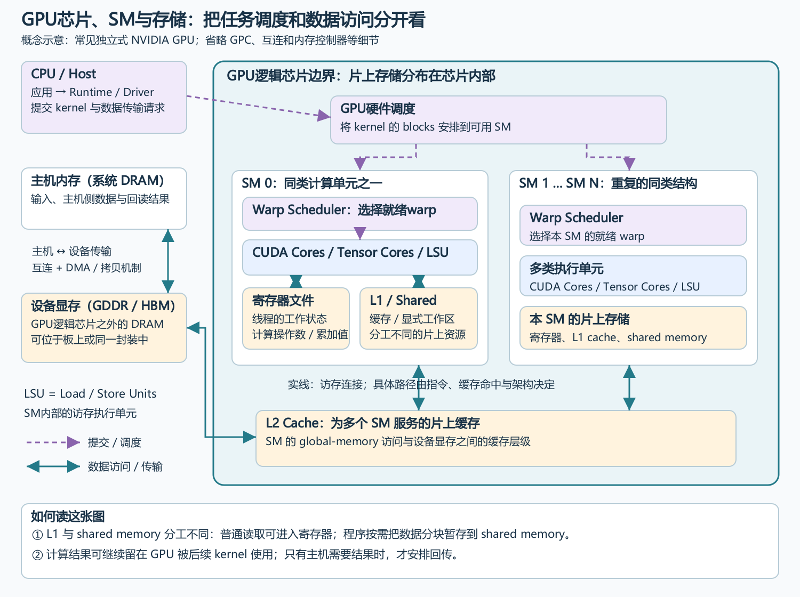
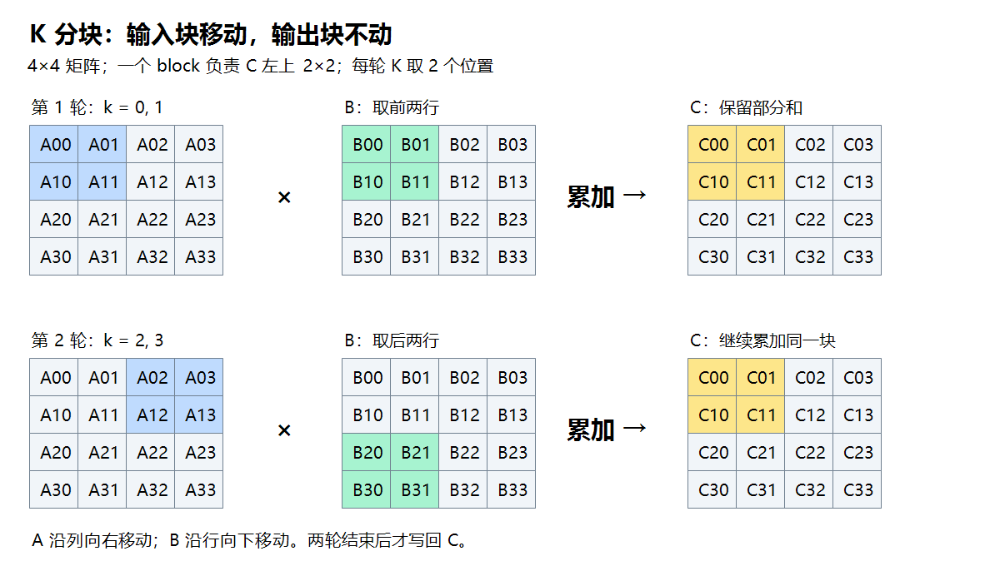
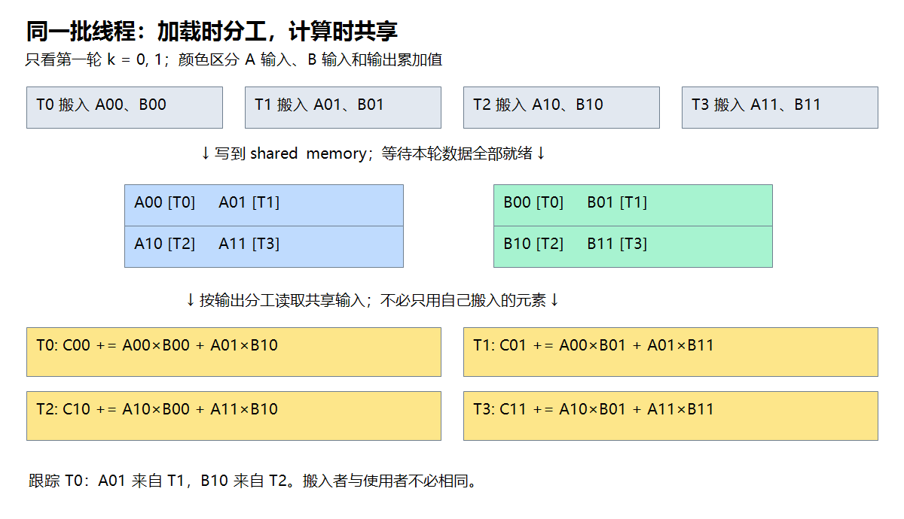
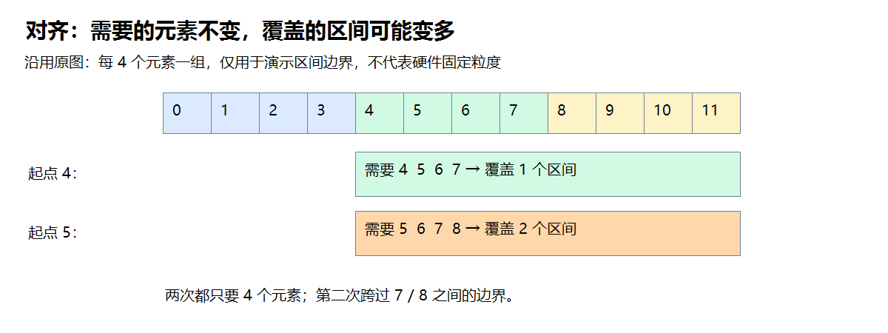

# 1 AI加速器基础与GPU计算访存优化

## 1.1 阅读主线

本文重点解释：**即使矩阵已经放得进一张GPU的显存，为什么仍然需要tiling，以及它怎样减少重复读取、提高计算效率。** 先用两小节说明硬件设计取舍和分支执行，再用表格、图示与连续算例拆解矩阵乘法。

## 1.2 CPU、GPU与TPU：资源主要用来解决什么问题

CPU侧重让少量、复杂且有依赖的任务尽快推进：处理分支、不可预测的访问和前后依赖，需要较多控制资源。GPU侧重同时推进大量相似计算：让许多数据共享执行安排，以较高吞吐完成批量工作。因此，规则的矩阵计算容易发挥GPU优势，细碎且路径分化严重的逻辑则可能让很多执行位置空着。

TPU与GPU在“以大量并行计算提高吞吐”这一方向上接近。区别可先落到矩阵计算的组织：GPU在可编程SM中配合Tensor Core执行矩阵块运算；TPU更围绕矩阵阵列的数据流安排乘加，让数据在阵列内按规则传递。

### 1.2.1 “Single Instruction”为什么影响if与mask的选择

一个warp中的线程共享指令执行安排，lane就是线程在warp中的位置。下面只画其中4个位置：它们的输入分别为2、−3、4、−1，需要完成以下计算：

```text
如果 x > 0：y = x + 1
否则：     y = x - 1
```

这些线程有的做加法，有的做减法。执行加法时启用lane 0和2，执行减法时启用lane 1和3：

| 执行过程 | lane 0 | lane 1 | lane 2 | lane 3 |
|---|---|---|---|---|
| 输入x | 2 | −3 | 4 | −1 |
| 加法阶段 | 2+1 → 3 | 等待 | 4+1 → 5 | 等待 |
| 减法阶段 | 等待 | −3−1 → −4 | 等待 | −1−1 → −2 |
| 最终y | 3 | −4 | 5 | −2 |

每个阶段只有一部分线程在做有效工作，这就是条件分化带来的利用率损失。如果四个输入都为正，所有线程便可以一起做加法，跳过减法路径。因此，判断一个if是否昂贵，要看同一warp的线程是否选择相同路径，以及路径有多长。

对于这样短的分支，编译器可能把“判断后跳到某段代码”改成“给指令附上执行条件”：

```text
发出加法指令，启用条件为 x > 0 的线程
发出减法指令，启用条件为 x <= 0 的线程
```

这种安排叫 **predication（谓词执行）**。它省去部分分支跳转与路径管理工作；加法、减法指令仍要安排执行，因而短分支比较适合这种做法。上表也可以帮助观察哪些线程在每一步产生结果。

再看“先算好，再挑结果”的写法：

```text
a = x + 1
b = x - 1
y = 根据 x > 0，选择 a 或 b
```

若按这个顺序执行，lane 0会先算出3和1，再选3；lane 1先算出−2和−4，再选−4。四个线程都做了两次算术，再各保留一个结果。加减很便宜时，这种额外工作可能值得；如果两侧都是耗时很长的函数，同时计算两侧的成本就明显增大。源码最终采用哪种执行安排，由编译器决定，性能比较要以生成代码和计时为依据。

后面tiling还会用到另一种mask：例如一个tile预留4个位置，但矩阵边缘只剩3个有效元素，就使用`[真, 真, 真, 假]`控制加载。前三个线程读取数据，第四个跳过这次读取，从而保护数组边界。mask应作用在加载发生时；若先读取全部4个位置再把最后一个乘0，第4次访问已经发生，仍有越界风险。

这几个例子分别说明了路径分化、短分支处理和边界访问。它们的性能取舍取决于实际省下的控制或访存工作，以及额外执行了多少指令。[NVIDIA控制流说明](https://docs.nvidia.com/cuda/cuda-c-best-practices-guide/index.html#control-flow)

## 1.3 先区分：分到别的GPU，还是在同一GPU内分批搬运

TP沿模型算子维度把计算交给多张GPU，涉及跨设备的数据和结果协作。本篇的tiling则发生在单张GPU内部：完整A、B仍可放在设备显存中，一个block每次只搬入当前需要的输入块，在片上反复使用。

这里的两层目标是：**输出分块带来跨输出的数据复用；K分块让每轮输入工作集适配有限的片上存储。** 完整A、B、C通常仍占用原来的显存空间，优化发生在计算过程中：同一份输入搬入片上后，被多个输出重复使用。

存储位置直接看已有图：



后面的图解只需记住三个位置：A、B完整数据在设备显存；这一轮共享的输入块放到shared memory；输出部分和尽量留在寄存器，累加结束再写回。更完整的层级解释见[[02_Projects/AI-Career-Transition/10_学习文档/P02A-01_VLM模型工程认知_学习文档#1.3.8 Memory hierarchy：芯片、SM与数据移动]]。

## 1.4 四个线程为什么在重复取数据

设两个4×4矩阵相乘，**A×B=C**。四个线程分别计算左上角四个输出，每行列出该线程沿k依次执行的乘法：

| 线程 → 输出 | k=0 | k=1 | k=2 | k=3 |
|---|---|---|---|---|
| T0 → C00 | A00·B00 | A01·B10 | A02·B20 | A03·B30 |
| T1 → C01 | A00·B01 | A01·B11 | A02·B21 | A03·B31 |
| T2 → C10 | A10·B00 | A11·B10 | A12·B20 | A13·B30 |
| T3 → C11 | A10·B01 | A11·B11 | A12·B21 | A13·B31 |

这张表有两个阅读方向：**横向**是一名线程随k增加，依次完成自己的点积；**纵向**是不同线程在同一个k需要哪些数据。寻找跨线程复用，先纵向看k=0：

| 线程及输出 | 当前乘法 | 与谁共享输入 |
|---|---|---|
| T0 → C00 | A00 × B00 | A00也被T1使用；B00也被T2使用 |
| T1 → C01 | A00 × B01 | A00与T0相同；B01与T3相同 |
| T2 → C10 | A10 × B00 | A10与T3相同；B00与T0相同 |
| T3 → C11 | A10 × B01 | A10与T2相同；B01与T1相同 |

四次乘法若各自取两个输入，就有8次逻辑加载需求，但实际只需要A00、A10、B00、B01四个不同元素。到下一个k，这种重复又出现一次。问题由此变得具体：**能否由线程合作搬入这些输入，再让需要它们的输出共同使用？**

这张表还可用来检查地址：横向看，一名线程随k读取B的一列；纵向看，同一k处的多个线程可能读取相同或相邻元素。第1.6节将按纵向的线程地址排列解释访存合并。这里先统计共享输入，实际HBM流量还需结合缓存与测量判断。

## 1.5 Tiling怎样把“各取各的”改成“搬一次、共同用”

### 1.5.1 先固定输出区域，再决定这一轮搬哪些输入

用M、N表示输出的行数与列数，K表示点积长度，即A为M×K、B为K×N。继续使用4×4的A、B，只计算C左上2×2。四个线程继续计算各自的点积，同时把所需输入合起来加载和复用。令每轮处理两个k位置：第一轮k=0、1，第二轮k=2、3。



读第一行：蓝色A块提供两行在k=0、1处的值，绿色B块提供两列在k=0、1处的值，乘积累加到黄色C块。读第二行：A块向右移、B块向下移，补上k=2、3的贡献；黄色输出区域没有移动。

以C00为例，它一直在算同一条行列点积，只是拆为两轮：

$$C_{0,0}=\underbrace{A_{0,0}B_{0,0}+A_{0,1}B_{1,0}}_{\text{第一轮}}+\underbrace{A_{0,2}B_{2,0}+A_{0,3}B_{3,0}}_{\text{第二轮}}.$$

例如A第0行为[1,2,3,4]，B第0列为[5,6,7,8]，两轮分别贡献17与53，最终为70。实际浮点实现改变累加顺序时可能存在舍入差异。**M/N分块决定算哪片输出，K分块决定这片输出当前累加哪一段。** “沿K归约”与“行乘列”是同一运算的两种观察方式。

### 1.5.2 看一轮内部：谁搬入，谁使用

第一轮需要A左上2×2和B左上2×2，共8个输入。让四个线程各搬一个A元素和一个B元素，然后再按输出分工计算：



把图拆成两步。第一步，四个线程把输入写到共享数组S_A、S_B：

| 加载线程 | 写入S_A | 写入S_B |
|---|---|---|
| T0 | S_A[0,0] = A00 | S_B[0,0] = B00 |
| T1 | S_A[0,1] = A01 | S_B[0,1] = B01 |
| T2 | S_A[1,0] = A10 | S_B[1,0] = B10 |
| T3 | S_A[1,1] = A11 | S_B[1,1] = B11 |

第二步，等待输入就绪后，每个线程用共享数组计算自己的输出。以T0负责的C00为例，本轮累加：

$$
C_{0,0}\mathrel{+}=
\underbrace{S_A[0,0]}_{T0\text{加载}}\,
\underbrace{S_B[0,0]}_{T0\text{加载}}
+
\underbrace{S_A[0,1]}_{T1\text{加载}}\,
\underbrace{S_B[1,0]}_{T2\text{加载}}.
$$

公式下方标出了每个操作数的加载者：T0计算一个输出时，会使用T0、T1、T2共同准备的数据。

再把两个同行输出并排写出来，观察A的复用：

$$
\begin{aligned}
T0:\quad C_{0,0}&\mathrel{+}=\boxed{S_A[0,0]}S_B[0,0]+\boxed{S_A[0,1]}S_B[1,0],\\
T1:\quad C_{0,1}&\mathrel{+}=\boxed{S_A[0,0]}S_B[0,1]+\boxed{S_A[0,1]}S_B[1,1].
\end{aligned}
$$

两条公式中的方框是同一对共享输入，各自搬入一次后，供两个输出使用。B同样沿输出行方向复用，例如S_B[1,0]同时参与C00与C10的计算。

**加载分工决定“谁把元素放进共享数组”，计算分工决定“谁计算哪个输出”。** 两套分工通过S_A、S_B连接，这就是加载映射与计算映射解耦。

再数一次第一轮：四个输出各做两次乘加，独立加载需$4×2×2=16$次标量输入需求；协作加载只需搬8个不同输入，再在片上复用。第二轮也是如此。第1.4节中每个输入服务两个输出的关系，在这一轮的两个k位置上各发生一次。

共享带来依赖：计算前必须确保本轮输入写好，下一轮覆盖缓冲区前必须确保其他线程已用完。例如T1还未写入A01时，T0应等待；T0还在使用A01时，T1也应等它用完，再将该位置改写为下一轮输入。C的部分和保留到下一轮，全部K处理结束才写回，避免每轮把部分和往返显存。

### 1.5.3 为什么K也要分块：放得进显存，不等于放得进片上

假设一个block计算64×64输出，K=4096，输入FP16。若把这些输出需要的完整A条带与B条带一次装进片上，需：

$$ (64×4096+4096×64)×2\ \mathrm{bytes}=1\ \mathrm{MiB}.$$

而每轮只取32个k位置，输入块变成64×32与32×64，总共8 KiB。循环128轮，算的仍是同一64×64输出块。片上保留当前轮的输入；这一轮用完后，复用同一块空间装入下一轮。若要提前准备下一轮数据，可额外增加缓冲区。

这里同时发生两件事：**M/N方向把多个输出放在一起，让A跨列复用、B跨行复用；K方向把输入分批，控制片上工作集。** 这两步配合起来，既让当前块装得下，也让搬入的数据被多个输出使用。

### 1.5.4 复用能省多少，以及这个数字代表什么

还是64×64输出、每轮K=32。独立加载的逻辑输入量为$(64×64×32×2×2)$ bytes，即512 KiB；协作输入块为$(64×32+32×64)×2$ bytes，即8 KiB。两者相差64倍，因为每个A值可供64列输出使用，每个B值可供64行输出使用。

这个64倍按“每次独立加载都重新取数”估算。真实运行中，原实现的一部分请求可能已经命中cache；分块实现也需要同步并读取shared memory。因此，实际HBM流量和耗时的改善幅度需要分别测量。此处最重要的变化是：**原本反复向较远存储请求的数据，变成搬近后反复使用。**

增大输出tile通常增加复用，但也增加输出累加寄存器；增大K tile会增加每轮输入缓冲。例如K tile从32增到64，每轮输入从8 KiB变成16 KiB，运算量也加倍，每字节对应的理想运算量保持相同。输入缓冲和输出累加值占用更多资源后，一个SM可能同时容纳更少的blocks；寄存器不足时，部分值还可能转存到更慢的存储中（spill）。选择tile大小，就是在复用收益与这些成本之间取舍。

## 1.6 复用之外，还要把每一次加载组织好

### 1.6.1 跟着四个线程检查A与B的加载地址

先把相邻线程安排为计算C的同一行。在某个k，T0～T3读取A0k、A0k、A0k、A0k，以及Bk0、Bk1、Bk2、Bk3：A是同地址，B是连续地址。若改为计算C的同一列，A才会变成跨行读取，B则同地址。输入地址的排列，随线程负责的输出位置一起变化。

利用共享工作区，加载线程可以先沿A的行搬A，再沿B的行搬B。计算时再从shared memory取所需行列。第1.5.2图正是在说明这种自由。

把图中的加载顺序写成地址，就能进一步检查连续性：若原矩阵行宽为4，A00、A01、A10、A11的元素偏移是0、1、4、5，只有每行内部连续。检查真实warp时，也按这个方法列出同一次指令的地址，再结合每个线程读取的字节数和有效位置，判断这些访问需要覆盖哪些存储区间。

### 1.6.2 对齐：连续元素跨了哪一条边界

先用每4个元素一个访问区间的教学模型，比较两次连续读取。绿色区间包含4～7，黄色区间包含8～11：



读4、5、6、7时，都在同一区间；读5、6、7、8时，8进入下一区间。两次请求的元素都连续，但第二次跨过7/8之间的边界。**连续描述元素之间的关系，对齐描述它们相对访问边界的位置。** 计算仍由同一个block负责，变化的是读取请求覆盖的存储区间。

每4元素一组只是图中的教学模型。若换成32个lane各读一个FP32、按32-byte sectors计覆盖：128 bytes的连续数据从32-byte对齐位置开始，覆盖4个sectors；偏移4 bytes则覆盖5个，覆盖效率为128/160=80%。这个例子的覆盖量增加了25%；实际传到HBM的请求还会受到缓存复用影响。

二维矩阵还要看行跨度。行主序地址为$base+(i×lda+k)×s$，lda是实际每行跨度（元素数），s是每元素字节数。即使base对齐，行宽或tile起点不合适，后续行仍可能错位；padding、合适的tile尺寸和加载宽度都可能改善它。FP16下，base按32 bytes对齐、lda与k起点均为16的倍数，可使该起点对齐。接下来再按第1.6.1节的方法，检查其余lane的地址排列。

## 1.7 把tiling放回显存优化框架

现在可以把几种优化的差别讲具体。Tiling让同一输入在片上服务多个输出；fusion让前一个算子的中间结果直接被后一个消费，减少写回再读；recomputation则少保存一部分中间值，到需要时再算。这些方法都围绕数据，却作用于不同环节。

例如$u=f(x)$、$y=g(u)$分成两个kernel时，u可能先写显存再被读取；融合后可在片上接续使用。它减少的是中间往返。训练中舍弃某些activation、反向时重算，则主要以额外计算换峰值容量。普通GEMM tiling主要优化流量；FlashAttention结合tiling与在线softmax，避免完整score/probability矩阵物化，才进一步改变大中间张量的存储需求。在线softmax见P02A-01第1.4.6节。

低精度会改变部分张量的字节数与计算路径，分片或offload会改变数据存放位置；这些仍需结合数值质量和通信成本。判断优化时，先明确要减少“同时存活多少数据”还是“反复搬多少数据”，再选择方法。

最后回到测量：固定shape、stride、dtype与正确性容差，预热并覆盖GPU实际完成，再比较耗时与相应存储层级的流量。若tile扩大后流量下降、耗时反升，应继续检查寄存器、shared memory、并行工作量和同步；最终选择应同时依据流量和耗时的变化。本文所有数字均为教学推导，未运行GPU实验。

## 1.8 来源与图示说明

本篇借助[CS336 2026 Lecture 5：GPUs, TPUs](https://www.youtube.com/watch?v=izZba4UA7iY)的主题框架，结合既有P02A-01和官方资料整理。

详细来源与本轮核对补充见[[04_Sources/模型工程/2026-11-20_AI加速器与GPU访存优化来源记录]]。合集入口见[[02_Projects/AI-Career-Transition/10_学习文档/学习文档索引#1.6 模型性能优化专题合集]]，写作原则见[[02_Projects/AI-Career-Transition/00_规划/学习文档维护规范#1.9 性能优化补充学习的专题写作原则（2026-11-20）]]。
