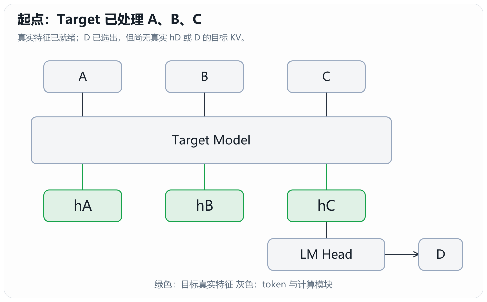
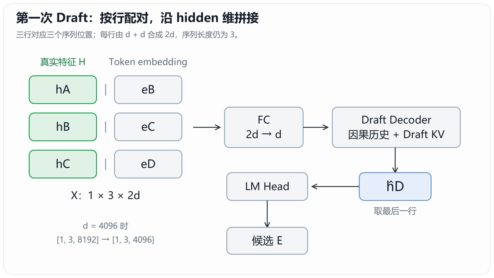
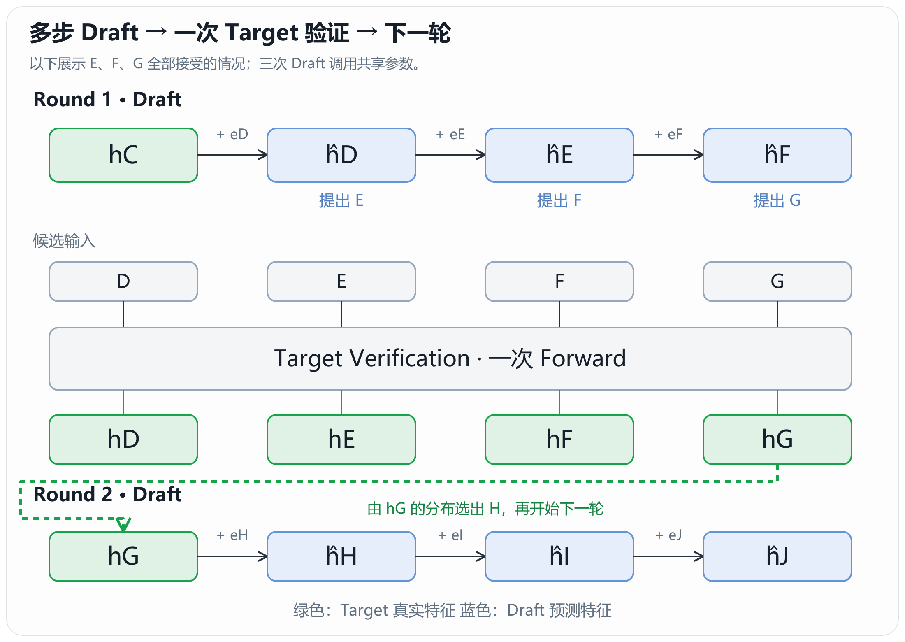
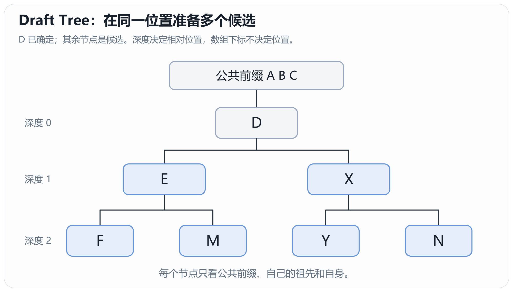
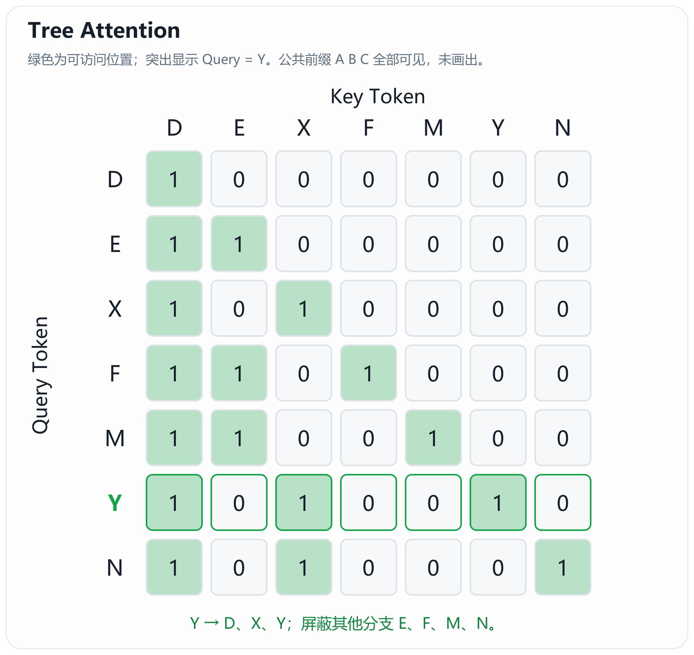
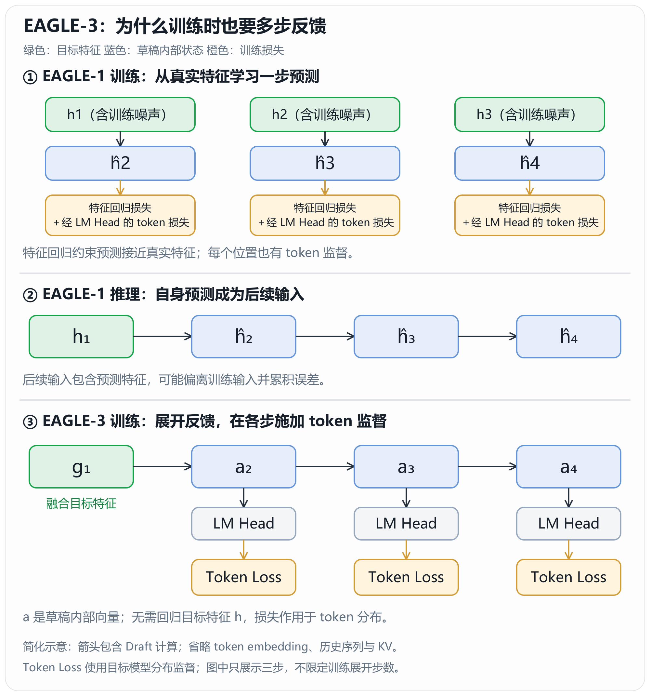
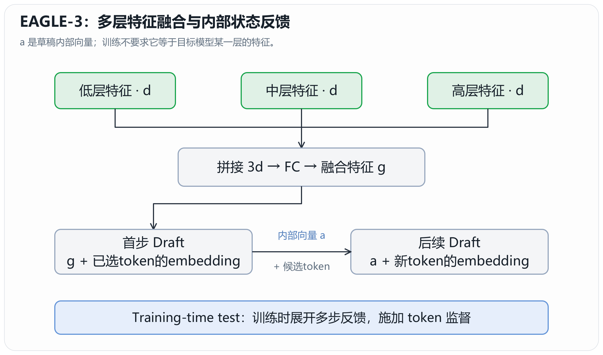

# 1 自回归模型推理的性能瓶颈分析与优化

同一个模型，长提示词可能让首次响应变慢，长历史可能让后续每个token变慢，增加并发又可能提高总吞吐。解释这些现象，需要先列出每次执行的工作，再看数据怎样保存、搬运和复用，最后判断哪项成本限制了目标指标。

本文沿“明确目标→建立成本→判断瓶颈→选择干预→验证收益”展开。重点是线性层和Attention的连续推导，再用它解释KV压缩与投机解码。

## 1.1 先确定哪一种“更快”

设请求提交时刻为$t_0$，第一个输出token可用时刻为$t_1$，最后一个为$t_N$。在同一客户端观测边界下，首token延迟TTFT为$t_1-t_0$。当$N>1$时，平均后续token间隔TPOT为$(t_N-t_1)/(N-1)$。完整结果可用的时刻还可能包括解析、校验和业务处理。

例如生成100个token，首token在200 ms出现，最后一个在2180 ms出现，则平均TPOT为20 ms，后续生成速率为50 token/s，按全部输出和完整请求时间计算的速率约为45.87 token/s。系统吞吐则用测量窗口内所有请求完成的工作量除以窗口时间，需要注明请求数或token数、输入或输出以及稳态范围。

对结构化VLM任务，首个“{”表示输出开始，业务结果在完整内容生成并通过校验后可用。时间线应覆盖图像预处理、视觉编码、语言Prefill、Decode和后处理。

## 1.2 从线性层建立计算与流量账目

### 1.2.1 同一份权重服务多少个token

考虑一个线性层$Y=XW$，$X:[M,D]$、$W:[D,F]$、$Y:[M,F]$。$M$是本次处理的token行数，$D$和$F$是输入、输出特征维度。一次乘加计2 FLOPs，忽略bias，则逻辑计算量为$2MDF$。

先建立一个理想流量模型，假设X和W各读一次，Y写一次，三者每元素均占$b$字节。逐项相加可得到总字节数及算术强度。

$$
Q_{\mathrm{ideal}}=b(MD+DF+MF),\qquad
I_{\mathrm{ideal}}=\frac{2MDF}{b(MD+DF+MF)}.
$$

这里$Q$表示字节数，$I$表示算术强度，单位为FLOPs/Byte。该式从张量数量估算必要传输。如果数据已驻留cache，实际DRAM读取可更少。如果不同tile反复读取或出现spill，实际传输又可能更多。使用实测流量时，记录对应层级和范围，便于将测量值与这份账目对照。

普通整段Prefill对每条序列处理$S$个输入token，Batch为$B$，因此$M=BS$。普通单步Decode每条序列输入一个新token，因此$M=B$。变长打包、分块Prefill和多候选验证，应按当次实际token数计算$M$。

### 1.2.2 为什么会得到AI约等于B或BS

当$DF\gg M(D+F)$时，权重流量占主要部分，公式近似为$I\approx2M/b$。FP16或BF16下$b=2$，得到Decode的$I\approx B$和Prefill的$I\approx BS$。多行输入共同使用W，增加了每个权重对应的计算次数。

随着M继续增大，输入和输出传输也增长，完整公式的极限给出了收益上界。

$$
\lim_{M\to\infty} I_{\mathrm{ideal}}=\frac{2DF}{b(D+F)}.
$$

取$D=F=4096$、$b=2$，可把公式化为$I=4096M/(4096+2M)$。下表比较完整计算与权重主导近似。

| 本次token行数M | 理想AI，FLOPs/Byte | 权重主导近似M |
|---:|---:|---:|
| 1 | 1.00 | 1 |
| 16 | 15.88 | 16 |
| 128 | 120.47 | 128 |
| 2048 | 1024.00 | 2048 |

最后一行中激活流量已经显著影响结果。这个变化说明，Batch或序列长度增大带来的复用收益会逐渐饱和。完整MLP通常还包含多个投影、激活和逐元素乘法，应按它们是否融合重新列账。

## 1.3 Attention的流量为什么取决于实现

### 1.3.1 先固定Q、K、V与中间结果

考虑单个head的稠密非因果Attention，$Q:[T,d]$、$K,V:[S,d]$，其中T为Query长度，S为KV长度，d为head维度。计算先形成$A=QK^\top$，再得到$P=\mathrm{softmax}(A/\sqrt d)$，最后计算$O=PV$。A和P均为$[T,S]$，O为$[T,d]$。为突出矩阵计算与流量，先忽略Softmax的FLOPs及额外统计量，主计算量为$4TSd$。

如果仅分析一个独立的$QK^\top$算子，并假设输入与输出每元素均占b字节，将输入读取与score写回相加，得到以下理想算术强度。

$$
I_{QK^\top}=\frac{2TSd}{b(Td+Sd+TS)}.
$$

分母中的TS来自score写回。分析完整Attention时，则应把后续Softmax和PV的读写也计入。

### 1.3.2 分步执行与理想融合的差别

设Q、K、V各读一次，O写一次。分步实现还把A写出、读回，将P写出、读回。按全部张量占b字节，将读写逐项列在下表。

| 项目 | 分步实现 | 理想融合模型 |
|---|---:|---:|
| Q与O | $2bTd$ | $2bTd$ |
| K与V | $2bSd$ | $2bSd$ |
| A与P的往返 | $4bTS$ | 在片上处理 |
| 合计流量 | $b(2Td+2Sd+4TS)$ | $b(2Td+2Sd)$ |

因此在$b=2$时，理想融合模型可化简为下式。

$$
I_{\mathrm{ideal,fused}}=\frac{4TSd}{2(2Td+2Sd)}=\frac{TS}{T+S}.
$$

取$T=S=2048$、$d=128$，分步模型的AI约为60.24 FLOPs/Byte，理想融合模型为1024 FLOPs/Byte。两者采用相同的主计算量，差异来自A、P的传输。

FlashAttention通过分块与在线Softmax减少中间矩阵的显存往返。片上容量有限，实际跨tile访问会带来重复加载，因此上表融合一列是乐观流量模型，真实IO要结合分块算法和实测。因果Attention若跳过上三角块，计算量与访问量也需相应调整。[FlashAttention原论文](https://arxiv.org/abs/2205.14135)

### 1.3.3 Decode增加历史长度，为什么AI仍很低

普通Decode中$T=1$。将它代入上述FP16理想融合模型，可得到以下极限。

$$
I=\frac{S}{S+1}\longrightarrow1.
$$

历史变长，QK和PV的计算量近似随S增长，KV读取量也随S增长，每份KV服务的Query数维持一个。对KV独立的多个请求，B同时乘到计算量和流量上，因此在这个模型中约掉。

Batch仍可能增加可并行任务、改善设备利用率。AI相近时，时间也可能变化。这个结果对应单Query、标准MHA和上述流量模型。后面的GQA与多token验证增加了每份数据可服务的Query，复用条件随之变化。

## 1.4 容量、带宽和执行效率怎样限制速度

容量先决定某项配置能否执行。各层配置相同、K/V维度相同时，标准KV缓存可按每个token的K和V元素数逐层累加。

$$
C_{\mathrm{KV}}=2BLSH_{\mathrm{KV}}d\,b.
$$

L为层数，$H_{\mathrm{KV}}$为KV head数。实际分配还包括页内空余、对齐、元数据和临时区。总显存同时容纳权重、KV、激活与运行时工作区。取$B=1,L=32,S=8192,H_{\mathrm{KV}}=32,d=128,b=2$，逻辑KV为4 GiB。这个数字用于容量规划。

若每步全层Attention都从DRAM读取一次这些KV，又会产生约4 GiB的读取需求。后一判断额外依赖数据访问与缓存条件。权重同样要被消费，短历史、小Batch下应同时比较权重与KV流量。

对已选定的kernel，设计算量为$\mathcal F$，对应存储层流量为Q，执行时间为t，可用下式将实测性能与Roofline上界对应起来。

$$
I=\frac{\mathcal F}{Q},\quad
P=\frac{\mathcal F}{t},\quad
P\le\min(P_{\mathrm{peak}},BW_{\mathrm{peak}}I).
$$

计算上限应匹配dtype和指令路径，带宽上限应匹配所统计存储层。用shape推导的数学FLOPs进行分析时，也要标明它与包含padding、重计算的硬件工作量可能存在差异。[NVIDIA Roofline说明](https://developer.nvidia.com/blog/accelerating-hpc-applications-with-nsight-compute-roofline-analysis/)

例如假设100 GFLOPs、20 GB的DRAM流量、100 TFLOPs/s的相应计算上限及2 TB/s带宽，计算耗时下界为1 ms，搬运下界为10 ms。简化模型取两者较大值10 ms。若实测50 ms，应继续检查并行规模、访问依赖和同步。若已接近10 ms，减少DRAM流量更有希望直接缩短时间。

| 观测问题 | 下一项证据 | 干预目标 |
|---|---|---|
| 长上下文或高并发触发OOM | 权重、KV、临时区的峰值占用 | 降低存储需求或改善分配 |
| 大量时间用于数据移动 | 实际流量、层级带宽和cache行为 | 减少搬运或提高复用 |
| 流量较低、执行耗时较长 | grid规模、就绪warp、依赖和同步 | 提供可并行工作、隐藏等待 |
| 计算路径接近吞吐上限 | 对应精度的计算量和执行管线 | 减少计算或选择适合的计算路径 |
| GPU工作之间有明显空档 | CPU提交、排队、通信和依赖时间线 | 缩短关键路径上的空档 |

具体判读方法见[[01_Knowledge/性能分析/GPU执行与存储瓶颈分析]]。本篇用这些证据检查前面推导出来的假设。

## 1.5 优化一次执行，让搬入的数据服务更多计算

### 1.5.1 把GEMM分块换算成AI

沿用P02A-03的分块过程，一个block计算$B_M\times B_N$输出，每轮处理$B_K$个归约位置。该轮读取$B_MB_K+B_KB_N$个输入元素，执行$2B_MB_NB_K$ FLOPs。将本轮计算量除以输入字节数，得到以下复用指标。

$$
I_{\mathrm{tile,input}}=
\frac{2B_MB_NB_K}{b(B_MB_K+B_KB_N)}
=\frac{2B_MB_N}{b(B_M+B_N)}.
$$

取$B_M=B_N=64,B_K=32,b=2$，输入8 KiB，计算262144 FLOPs，AI为32 FLOPs/Byte。若只把$B_K$加倍，输入和计算同时加倍，该口径下的AI维持32。增加输出tile尺寸则能提高输入复用，同时增加累加器和缓冲需求，可能压低驻留数量或引入spill。

完整K计算结束还要写回输出，多个block之间也可能重复加载同一条带。因此，单轮tile的输入AI、整算子的理想AI和实测DRAM AI应分别标注。

### 1.5.2 把优化选择落实到可观测变化

融合使前一操作的中间结果直接被下一操作消费，可减少写回和再次读取，也可能增加寄存器占用。布局调整影响一次warp访问覆盖的事务数量。流水安排通过提前准备下一轮数据隐藏等待，额外缓冲又会占用片上空间。这些取舍共同决定绝对耗时。

选择CUDA或Triton实现后，仍需固定shape、stride和dtype，比较tile大小、warp组织和流水配置。预期提高复用的修改，应检查字节数是否下降。预期改善并行的修改，应检查设备活动和等待是否改善。小算子的启动成本明显时，可进一步考察融合或执行图复用，并在端到端时间线上验证。

权重量化与KV量化还会降低相应元素的存储字节数。混合精度账目应分别计算权重、激活和输出，量化元数据、解量化、布局变换也需计入。文件变小之后，仍要核对实际计算路径与任务质量。

## 1.6 改变历史信息的保存与访问方式

### 1.6.1 GQA减少独立KV heads

MHA表示Multi-head Attention。GQA表示Grouped-query Attention。设Query heads有$H_Q$个，KV heads有$H_{\mathrm{KV}}$个，每组$g=H_Q/H_{\mathrm{KV}}$个Query heads共享KV。GQA通过减少独立KV heads缩小缓存，需要相应模型权重或适配训练。[GQA原论文](https://arxiv.org/abs/2305.13245)

沿用前面的4 GiB容量算例，将KV heads从32减为8，其余条件不变，逻辑容量降到1 GiB。单步Decode的主Attention计算量仍约为$4BH_QSd$。若共享KV从目标存储层各读取一次，则可得到KV流量主导时的AI估算。

$$
I\approx\frac{4BH_QSd}{2BH_{\mathrm{KV}}Sd\,b}=\frac{2g}{b}.
$$

FP16下得到$I\approx g$。这个推导要求实现有效复用共享KV。扩展视图、重复加载或不同tile组织会改变实际流量。

### 1.6.2 MLA保存联合压缩表示

MLA表示Multi-head Latent Attention。以DeepSeek-V2为例，它将KV联合压缩为latent，并单独保存解耦的位置相关Key信息。上投影可以吸收到Query和输出投影中，从而避免每步展开全部历史的高维KV。令c为压缩表示、$U_K$为Key上投影矩阵、q为Query，则$q^\top(U_Kc)=(U_K^\top q)^\top c$展示了把投影移到Query侧的重排。RoPE的位置变换需要单独处理。容量可按每token的latent维度与额外位置维度之和估算，再乘B、L、S和元素字节数。[DeepSeek-V2 §2.1](https://arxiv.org/html/2405.04434v5#S2.SS1)

### 1.6.3 局部注意力限制每次访问的历史范围

滑动窗口Attention只让Query直接访问最近w个位置。配合滚动缓存，单层保留与访问的KV长度可限制为$\min(S,w)$。多层传播仍能间接携带更早的信息。直接访问范围与模型可用历史应分别解释。混合全局层、窗口层时，需要逐层累计容量和计算量。[Mistral 7B §2](https://arxiv.org/html/2310.06825v1)

### 1.6.4 Linear Attention兼具批量计算与递推形式

**Linear Attention通过汇总历史信息，降低长序列Attention的计算与存储成本。** 全历史标准Attention在Decode时保留并访问随历史长度增长的K/V。Linear Attention利用可分解的相似度，将历史汇总为固定大小的状态：**固定特征维度与状态精度时，历史序列变长，Decode状态大小保持不变，每步Attention核心的计算与状态读写量也与历史长度无关。** 同一套公式在训练和Prefill时可采用并行或分块计算，使Attention核心的总工作量随序列长度线性增长。下面从相似度的分解推导这种汇总与递推形式。

先从注意力怎样给Value分配权重看起。以单个head为例，位置t的Query为$q_t$，历史位置j的Key和Value为$k_j,v_j$，Query与Key的维度为d。标准因果Softmax Attention使用指数相似度，输出写成行向量时为：

$$
s_{\mathrm{softmax}}(q_t,k_j)=\exp(q_t^\top k_j/\sqrt d),\qquad
o_t=\frac{\sum_{j\le t}s_{\mathrm{softmax}}(q_t,k_j)v_j^\top}
{\sum_{j\le t}s_{\mathrm{softmax}}(q_t,k_j)}.
$$

每个权重都包含当前Query与某个Key的联合计算。要让历史信息先汇总、再由Query读取，需要把相似度分解成Query侧和Key侧各自的特征。为此，选择具有有限维特征映射的相似度函数：

$$
s_\phi(q,k)=\phi(q)^\top\phi(k).
$$

这里$\phi$把Query和Key各自映射到r维特征空间。它可以包含非线性变换，例如原论文采用$\phi(x)=\mathrm{ELU}(x)+1$，得到正值特征与非负相似度。生成Q/K/V的学习投影负责构造表示，$\phi$进一步决定这些表示如何计算相似度。这个选择定义了一种新的注意力核。若目标是逼近Softmax的指数核，则需采用相应的特征近似并分析近似误差。[Linear Attention原论文 §3.1–3.2.1](https://arxiv.org/html/2006.16236v3)

把$s_\phi$代入加权平均后，对同一个Query，$\phi(q_t)$在所有j项中相同，可以移到求和之外：

$$
\begin{aligned}
o_t
&=\frac{\sum_{j\le t}\bigl[\phi(q_t)^\top\phi(k_j)\bigr]v_j^\top}
{\sum_{j\le t}\phi(q_t)^\top\phi(k_j)}\\
&=\frac{\phi(q_t)^\top\left(\sum_{j\le t}\phi(k_j)v_j^\top\right)}
{\phi(q_t)^\top\left(\sum_{j\le t}\phi(k_j)\right)}.
\end{aligned}
$$

原先逐个计算“Query与Key的相似度，再乘Value”，现在可以先累积“Key特征与Value的外积”，最后由Query特征读取。若Value维度为$d_v$，每个外积$\phi(k_j)v_j^\top$的形状为$r\times d_v$，其计算是普通乘法。

据此定义历史汇总状态：

$$
A_t=\sum_{j\le t}\phi(k_j)v_j^\top,\qquad
z_t=\sum_{j\le t}\phi(k_j).
$$

$A_t$保存用于输出分子的加权信息，$z_t$保存归一化所需的Key特征和。第t步只比第$t-1$步多一项，因此可从零初值递推更新，并直接衔接到RNN形式。

$$
A_t=A_{t-1}+\phi(k_t)v_t^\top,\qquad
z_t=z_{t-1}+\phi(k_t),\qquad
o_t=\frac{\phi(q_t)^\top A_t}{\phi(q_t)^\top z_t}.
$$

沿数据流看，每个新token先向状态加入一份信息，再用Query读取累积状态。将$(A_t,z_t)$视为隐藏状态，就得到“上一状态与当前输入→更新状态→输出”的RNN表达。同一个因果Linear Attention既可写成对历史位置的加权求和，也可写成状态递推。训练通常利用整段输入批量计算，逐token Decode通常采用RNN式更新。实际实现按输入是否已知、并行规模和内存需求选择执行方式。[Linear Attention原论文 §3.3–3.4](https://arxiv.org/html/2006.16236v3)

**训练时，已知整段序列提供批量计算的机会。** Teacher forcing用已知、错位的训练序列构造各位置输入。在一层中，所有位置的Q/K/V及各自的状态增量可以批量生成。令$\Delta A_i=\phi(k_i)v_i^\top$，前三个位置的状态可展开为下面的前缀和。

$$
A_1=\Delta A_1,\quad
A_2=\Delta A_1+\Delta A_2,\quad
A_3=\Delta A_1+\Delta A_2+\Delta A_3.
$$

每项增量只依赖当前位置在该层的输入，状态组合采用加法，因此可以用前缀扫描（parallel scan）或分块方式组织累积。因果约束体现在每个位置只使用截至自身的前缀和。层与层之间仍按模型依赖推进，跨位置计算则有并行空间。

固定r和$d_v$时，这个注意力核心的总工作量按$O(Srd_v)$随序列长度S线性增长。朴素实现若保存所有矩阵状态，需要$O(Srd_v)$存储，训练中的反向计算可以利用累积结构或重计算控制这部分开销。训练仍需保存相应输入、激活或统计量，其内存规划应按实际反向实现核算。[Linear Attention原论文 §3.3.1–3.3.2](https://arxiv.org/html/2006.16236v3)

**Prefill将已知提示词转换为Decode的初始状态。** 长度为S的提示词已经给定，可以采用批量或分块形式计算各位置输出，并为每层保留末尾状态$A_S,z_S$。生成出的下一个token被送回模型时，从这组状态继续更新。分块Prefill同样可以把上一块的末尾状态传给下一块。

| 阶段 | 已知输入 | Attention的执行方式 | 需要保留什么 |
|---|---|---|---|
| 训练 | 整段错位训练序列 | 批量生成Q/K/V，计算因果前缀状态和各位置输出 | 按反向实现保存激活、统计量或分块检查点 |
| Prefill | 整段或当前块提示词 | 批量或分块累积状态并计算输出 | 每层提示词末尾的$A_S,z_S$ |
| 逐token Decode | 当前新输入token | 更新$A,z$，再用当前Query查询状态 | 每层更新后的$A,z$，供下一步使用 |

**逐token推理时，递推形式把工作集中到当前状态。** 本文的归一化形式每步先计算当前token的Q/K/V，再更新$A_t$和归一化状态$z_t$，最后用$\phi(q_t)$查询状态得到输出。当前token还要经过输出投影、MLP等层内操作。仅就上述Attention核心而言，每步工作量为$O(rd_v)$，持续状态规模为$O(rd_v+r)$。

固定状态大小可直接从形状看出：单层单head保留$A_t\in\mathbb R^{r\times d_v}$与$z_t\in\mathbb R^r$。若每个状态元素占$b_s$字节，则：

$$
M_{\mathrm{state}}=(rd_v+r)b_s.
$$

该容量与历史长度S无关；全历史标准Attention的单层单head KV缓存容量为$S(d_k+d_v)b_{KV}$，随S线性增长。整模型的状态容量需按层数、head数与并发请求数累计，混合架构中的其他缓存另行核算。固定状态大小描述的是递推Decode阶段，训练中的激活与反向计算存储仍按前述实现分析。[Linear Attention原论文 §3.3–3.4](https://arxiv.org/html/2006.16236v3)

训练侧的收益来自线性工作量和可组合的前缀计算，推理侧的收益来自固定规模状态与增量更新。两者共同依赖这种状态更新的代数结构。实际速度还取决于特征维度、kernel效率和反向实现，数值上需处理归一化分母的稳定性，模型质量则需验证长期信息在状态中的保留效果。

以上方法改变模型的数据表示或依赖关系，采用时需要评估长上下文任务和质量。PagedAttention则通过分页管理与共享提高KV内存利用率，可支持更多并发请求。每一步逻辑上需要访问多少KV仍取决于注意力和复用条件。[PagedAttention论文](https://arxiv.org/abs/2309.06180)

## 1.7 改变生成组织，提高一次调用的有效产出

### 1.7.1 Batching复用权重，同时改变请求等待

同时执行B条请求的Decode时，线性层可把B行输入合入同一次投影，为权重复用和并行提供机会。请求完成后补入新请求的连续批处理，有助于维持工作规模。历史长度与可用KV容量又限制了能组合多少请求。

因此，应同时测系统输出token/s、每请求TPOT、TTFT和排队时间。大Batch可能提高吞吐，也可能延长每个请求等待下一步的时间。分块Prefill可改变Prefill与Decode之间的调度粒度，具体效果需在相同到达负载下比较。

### 1.7.2 投机解码如何把串行生成变成多位置验证

普通自回归生成中，目标模型先给出下一个token分布，再采样出$x_1$。$x_1$确定后，才能构造预测$x_2$的输入。这种“计算分布→选定token→构造下一次输入”的依赖，使目标模型逐步推进。

投机解码先让较便宜的草稿模型提出一段候选。以已确认前缀h和4个候选$x_1,x_2,x_3,x_4$为例，目标模型要检查的条件分布如下。

| 要检查的位置 | 使用的已知输入前缀 | 目标分布 |
|---|---|---|
| $x_1$ | h | $p_1(\cdot\mid h)$ |
| $x_2$ | $h,x_1$ | $p_2(\cdot\mid h,x_1)$ |
| $x_3$ | $h,x_1,x_2$ | $p_3(\cdot\mid h,x_1,x_2)$ |
| $x_4$ | $h,x_1,x_2,x_3$ | $p_4(\cdot\mid h,x_1,x_2,x_3)$ |
| 全部通过后的下一位置 | $h,x_1,x_2,x_3,x_4$ | $p_5(\cdot\mid h,x_1,x_2,x_3,x_4)$ |

草稿使这些输入前缀提前确定。目标Transformer可以把候选作为多位置输入，在各层通过因果mask限制可见范围，批量计算对应位置的输出。位置间的采样等待被转换为一次已知序列的前向计算，模型深度方向仍逐层执行。已有前缀KV可以复用，首位置的logits可以来自已保存输出或相应输入位置，具体输入与logits错位由实现处理。[Speculative Decoding §2及Algorithm 1](https://proceedings.mlr.press/v202/leviathan23a/leviathan23a.pdf)

**验证结果按连续前缀提交。** 若$x_1,x_2$通过而$x_3$被拒绝，本轮提交$x_1,x_2$和修正token y。$x_4$对应的计算以旧候选$x_3$为前提，因此后续从$h,x_1,x_2,y$重新推进，并回退草稿模型和目标模型中受影响的候选KV。若4个候选全部通过，还可从$p_5$取一个token，本轮最多提交5个。缓存应与已提交前缀对应，刚采样的末token可由下一次前向补齐其KV。

**随机采样通过接受与修正保持目标模型的输出分布。** 给定当前前缀$h$，$p(x)=p(x\mid h)$是目标模型经过实际采样设置处理后的下一个token分布，$\hat p(x)=\hat p(x\mid h)$是草稿模型实际用于生成候选的分布。temperature、top-k、top-p等设置都应计入相应分布，筛选后需归一化。这里的“目标”指希望投机解码保持的模型输出分布；真实语言或数据分布通常未知。本文统一用$\hat p$表示草稿提议分布，与后文EAGLE论文记号一致；比较$p,\hat p$时使用同一个前缀。[Speculative Decoding §2.1–2.3](https://proceedings.mlr.press/v202/leviathan23a/leviathan23a.pdf)

**第一步：从草稿分布采样候选，并计算条件接受率。** 先采样$x\sim \hat p$，再独立生成均匀随机数$u\sim U(0,1)$，按以下概率接受候选：

$$
a(x)=\min\left(1,\frac{p(x)}{\hat p(x)}\right).
$$

当$u<a(x)$时接受，否则进入修正采样。从$\hat p$实际抽到的候选满足$\hat p(x)>0$，因此接受率中的比值有定义。若$\hat p(x)\le p(x)$，候选全部接受；若$\hat p(x)>p(x)$，按$p(x)/\hat p(x)$保留其中一部分，从而削减草稿分布多出的概率。

用固定前缀、词表只有A和B的教学例子说明。A和B代表同一位置的两个候选token：

| 候选token | 目标分布$p$ | 草稿分布$\hat p$ | 抽到该候选后的接受率$a$ |
|---|---:|---:|---:|
| A | 0.6 | 0.8 | $0.6/0.8=0.75$ |
| B | 0.4 | 0.2 | $\min(1,0.4/0.2)=1$ |

抽到A的概率为0.8，抽到后有75%的概率接受。例如$u=0.5$时接受，$u=0.9$时拒绝。抽到B后始终接受。条件接受率与整条路径的概率分别计算：

$$
\begin{aligned}
P(\text{抽到A且接受})&=0.8\times0.75=0.6,\\
P(\text{抽到A且拒绝})&=0.8\times0.25=0.2,\\
P(\text{抽到B且接受})&=0.2\times1=0.2.
\end{aligned}
$$

接受路径已经贡献A的0.6和B的0.2，还有0.2的概率进入修正路径。

**第二步：拒绝后，按整个词表的概率缺口重新采样。** 对每个token计算目标分布相对草稿分布的正向缺口，并归一化：

$$
r(x)=\frac{\max(0,p(x)-\hat p(x))}
{\sum_y\max(0,p(y)-\hat p(y))}.
$$

这个例子中：

$$
\max(0,p-\hat p)=(0,0.2),\qquad r=(0,1).
$$

因此，一旦发生拒绝，修正采样必然输出B。一般词表中可能有多个概率不足的token，修正路径按它们各自的缺口分配概率。$r$是“已经发生拒绝”条件下的分布，计算最终贡献时还要乘上拒绝概率：

| 最终输出 | 接受路径贡献 | 修正路径贡献 | 最终概率 |
|---|---:|---:|---:|
| A | 0.6 | $0.2\times0=0$ | 0.6 |
| B | 0.2 | $0.2\times1=0.2$ | 0.4 |

**第三步：证明接受与修正的概率之和等于$p$。** 对任意token，接受路径贡献两种分布重合的部分：

$$
P(\text{候选为}x\text{且接受})=\hat p(x)a(x)=\min(p(x),\hat p(x)).
$$

对于$\hat p(x)=0$的token，接受路径贡献直接为0。所有候选的总拒绝概率为：

$$
R=1-\sum_y\min(p(y),\hat p(y))
=\sum_y\max(0,p(y)-\hat p(y)).
$$

最后一个等式来自$\sum_y p(y)=1$。当$R>0$时，修正分布的归一化分母正好等于总拒绝概率，因此：

$$
P(\text{拒绝后输出}x)=R\,r(x)=\max(0,p(x)-\hat p(x)).
$$

将两条路径相加：

$$
\begin{aligned}
P(\text{最终输出}x)
&=\min(p(x),\hat p(x))+\max(0,p(x)-\hat p(x))\\
&=p(x).
\end{aligned}
$$

当$R=0$时，所有候选均接受，直接由接受路径得到$p$，无需计算修正分布。这一结论表示：在相同前缀下反复采样，最终各token的出现概率与直接从目标模型的$p$采样一致；单次生成结果可以不同。[Speculative Decoding Appendix A.1](https://proceedings.mlr.press/v202/leviathan23a/leviathan23a.pdf)

多token验证时，在每个位置使用该位置前缀对应的$p_i,\hat p_i$，依次检查并保留连续接受的候选。在首次拒绝处采样修正token，后续从新前缀继续生成。Greedy模式使用目标argmax作为确定性输出：检查候选与其是否一致，在首次分歧处采用目标token；并列最大值使用一致的选取规则。

### 1.7.3 验证怎样摊薄目标模型的成本

多位置验证扩大了线性层的token行数，为权重复用和矩阵计算提供更大的工作块。一次验证虽增加了计算量，却可能用较少的权重重复读取和调用开销，完成原本需要多次目标模型Decode的工作。实际收益同时取决于草稿成本和能够提交的候选前缀长度。

设一轮草稿、验证、额外处理分别耗时$T_d,T_v,T_o$，提交token数为N。对足够多轮的执行，可用总成本除以总提交量估算平均每token耗时。

$$
T_{\mathrm{token,spec}}\approx
\frac{\mathbb E[T_d+T_v+T_o]}{\mathbb E[N]}.
$$

沿用教学例子，普通Decode为20 ms/token，草稿4 ms、验证24 ms、额外处理2 ms。平均每轮提交3个token时，成本为10 ms/token。平均只提交1.2个时，成本升到25 ms/token。对应收益条件为$\mathbb E[N]>30/20=1.5$，这里假设一轮总成本保持30 ms。

增大候选长度会增加草稿与验证工作，较靠后的候选也更依赖前面全部接受。实验时应联合观察有效提交长度和一轮总耗时，选择使“一轮总耗时÷有效提交token数”最低的配置。目标设备已有较高计算利用率时，验证的额外计算更容易成为成本。原执行受权重读取或小工作量限制时，多位置复用更有发挥空间。

### 1.7.4 EAGLE怎样利用目标模型已经算出的特征

1.7.2解释了如何保持目标分布，1.7.3给出了加速条件。接下来的问题是：怎样让草稿既便宜，又更容易通过验证？独立的小语言模型需要用自己的网络从token提取上下文信息，而目标模型在Prefill或上一轮验证时已经完成了这项工作。EAGLE-1把这些已算出的高层特征交给轻量草稿网络，作为后续预测的起点。

这里用$h_t$表示目标模型在位置$t$、LM Head之前的真实特征，用$\hat h_t$表示草稿预测的特征。它们是上下文相关的隐藏表示，与各层Attention保存的K、V张量具有不同用途。复用$h_t$仍需要草稿网络维护自己的Attention状态；不能把目标模型的整套KV直接当成草稿KV。特征维度、归一化位置和缓存管理应按具体实现对齐。

**先分清“token已选出”和“该token的特征已算出”。** 设目标模型已处理`A B C`，得到$h_A,h_B,h_C$，再由$h_C$的输出分布选出D。此时D已经确定，但D还没经过目标模型，因而尚无真实的$h_D$及D的目标KV。EAGLE可以在这个间隙预测$\hat h_D$，再由它提出E。

**图1：Prefill结束后的起始状态。** A、B、C已有真实特征，D已选出但尚未经过目标模型。

为写清这一步，令$e_D$为D的embedding，$M_D$为草稿网络，$\operatorname{Head}$包含所需归一化、LM投影和概率处理。简写为：

$$
\hat h_D=M_D(h_C,e_D),\qquad
\hat p_E=\operatorname{Head}(\hat h_D),\qquad E\sim \hat p_E.
$$

下标E表示“提出E所在位置的分布”，不是只计算token E的一个概率。实际输入沿序列错位配对，例如$[h_A,h_B,h_C]$与$[e_B,e_C,e_D]$。

**为什么一定要把已经选出的D告诉草稿？** 同一个$h_C$可能采样出不同的下一个token，后续真实特征也随之不同。只给$h_C$，草稿无法知道此次走了哪条路径；加入$e_D$，便把预测条件限定到已经选定的D。这里“提前一个时间步”指每个$h_t$与下一个已知token的embedding $e_{t+1}$配对，所用token在执行该步时已经确定。

EAGLE-1将两种$d$维输入沿特征维拼接为$2d$维，再经FC降回$d$维，由一个Transformer Decoder层预测特征，并复用目标模型的Embedding与LM Head参数。论文将这种特征预测作为降低草稿难度的方法；连续向量本身并不能保证预测一定更容易。[EAGLE §2–3.1](https://arxiv.org/html/2401.15077v3#S3.SS1)

**把省略的历史序列展开，能看清拼接发生在哪个维度。** 以首次建立Draft KV Cache为例，目标模型已经处理A、B、C，并选出D。此时草稿接收两组按行配对的序列：

$$
\begin{aligned}
H&=[h_A,h_B,h_C],\\
E_{\mathrm{emb}}&=[e_B,e_C,e_D].
\end{aligned}
$$

这里用$E_{\mathrm{emb}}$表示embedding序列，避免与接下来提出的候选token E混淆。每个$h$和$e$都是$d$维向量；沿hidden dimension拼接后，每行仍对应一个序列位置：

$$
X=\operatorname{Concat}_{\mathrm{hidden}}(H,E_{\mathrm{emb}})
=\begin{bmatrix}
h_A & e_B\\
h_B & e_C\\
h_C & e_D
\end{bmatrix}
\in\mathbb R^{3\times 2d}.
$$

上式省略batch维。若batch为1、$d=4096$，则H与$E_{\mathrm{emb}}$各为$[1,3,4096]$，拼接后X为$[1,3,8192]$。

**图2：历史特征与错位token embedding如何进入第一次Draft。** 绿色表示目标真实特征，蓝色表示草稿预测特征，灰色表示token信息或计算模块；各节点也标明数据身份。图中每行中间的竖线表示拼接边界。

最后一行$[h_C,e_D]$在草稿Decoder中还能访问前面的配对行，因此$\hat h_D$由完整的因果历史参与计算。建立Draft KV Cache后，下一次线性草稿可只输入新增配对$[\hat h_D,e_E]$：拼接输入为$[1,1,2d]$，经FC得到$[1,1,d]$，历史由草稿自己的KV保留。

### 1.7.5 从三次草稿前向到一次目标验证，怎样形成闭环

先用线性候选把时间关系讲清楚。延续`A B C`已处理、D已选出但尚未处理的状态，同一个草稿网络依次执行以下三步，期间无需调用目标模型。

| 草稿步骤 | 本步特征与token条件 | 预测特征 | 由LM Head提出的候选 |
|---|---|---|---|
| 第1次前向 | 真实$h_C$、已确定的D | $\hat h_D$ | E |
| 第2次前向 | 预测$\hat h_D$、候选E | $\hat h_E$ | F |
| 第3次前向 | 预测$\hat h_E$、候选F | $\hat h_F$ | G |

第2步依赖第1步选出的E，第3步依赖第2步选出的F。因此，一轮提出多个token通常包含多次草稿前向，三步共享同一套草稿参数。第一步从目标真实特征启动，后续步反馈草稿自己的预测特征。特征误差可能在这一轮内累积，影响候选的接受率。

候选齐备后，目标模型在已有`A B C`的KV上，一次输入`D E F G`。这些输入token都已知，各层可按因果mask并行处理多个位置。每个输入位置的输出分布用于判断其后一个位置：

| 目标模型输入位置 | 得到的真实特征 | 输出分布的条件前缀 | 用途 |
|---|---|---|---|
| D | $h_D$ | `A B C D` | 验证E |
| E | $h_E$ | `A B C D E` | 验证F |
| F | $h_F$ | `A B C D E F` | 验证G |
| G | $h_G$ | `A B C D E F G` | 全部接受后再取一个token H |

全部接受时，本轮新增确认E、F、G、H；D在本轮开始前已确定，不重复计数。H尚未经过目标前向，下一轮便从$(h_G,e_H)$开始预测$\hat h_H$。若E通过、F被拒绝并修正成Y，则保留`A B C D E`的真实特征与目标KV，丢弃F、G分支，从$(h_E,e_Y)$开始下一轮。基于旧F算出的$h_F,h_G$虽来自目标模型，却不属于最终提交路径。

这形成“真实特征启动→预测特征多步反馈→目标验证→保留有效路径”的循环。草稿侧也要按最终路径回退并用新获得的真实特征更新输入状态。[EAGLE §3.1、§3.3](https://arxiv.org/html/2401.15077v3#S3.SS3)

**图3：三次串行Draft之后，目标模型一次计算四个位置。** 同一行中的三个预测特征来自同一草稿网络的三次调用，箭头旁标出本步所用的token embedding。图中展示全部接受后用真实$h_G$启动下一轮；中途拒绝时按前文保留有效前缀。

### 1.7.6 Draft Tree怎样扩大候选覆盖，并行计算哪些内容

线性候选只有一条路径：若D后提出的E被拒绝，其后的F、G就失去使用条件。树形草稿在同一位置保留多个备选，使目标最终选择另一token时，也可能已有对应后续路径。下面是教学用二叉树，D为已确定的根，其他字母表示候选节点；这不是论文默认配置。

**图4：候选树与路径隔离。** 实线表示候选的父子关系，节点中的深度决定相对位置编号；每个节点还可访问公共前缀。

先由$(h_C,e_D)$预测$\hat h_D$，用其分布提出E和X。随后分别以$(\hat h_D,e_E)$和$(\hat h_D,e_X)$预测两条分支的特征，再提出F、M和Y、N。E和X互不依赖，可以在同一次草稿前向中并行处理；下一深度仍要等待本深度的候选确定。若教学树每层完整二分，三次草稿前向分别提出2、4、8个候选，共14个候选节点。串行深度仍为3，计算量与临时存储则随节点数增加。

**目标模型同样需要知道每个节点属于哪条历史。** 把上图展平为`[D,E,X,F,M,Y,N]`后，普通三角因果mask会让X看到E、让Y看到F等互斥分支，改变条件分布。Tree Attention应允许所有节点访问公共前缀，并在树内只访问自身及祖先。位置编号也要反映路径中的位置，而不是展平后的数组下标。

| 节点 | 树内可见节点 | 相对D的位置编号 | 该节点输出分布对应的前缀 |
|---|---|---:|---|
| D | D | 0 | `A B C D` |
| E | D、E | 1 | `A B C D E` |
| X | D、X | 1 | `A B C D X` |
| F | D、E、F | 2 | `A B C D E F` |
| Y | D、X、Y | 2 | `A B C D X Y` |

表中省略了每个节点都可访问的`A B C`；绝对position ID还需加上前缀偏移。M、N分别与F、Y处于同一深度。由此，一次目标前向得到各条候选路径的真实条件分布。D处的分布判断E或X，E处的分布判断F或M；节点自己的输出用于预测下一token。

把图4展开成Attention可见性矩阵，可以直接检查跨分支信息是否被屏蔽。行是Query节点，列是Key节点；1表示允许访问，0表示屏蔽，公共前缀列仍省略。实现为加到attention score上的mask时，通常将允许位置置0、屏蔽位置置负无穷，不能直接把下列0/1矩阵当成加性mask。

**图5：Tree Attention的可见性矩阵。** 高亮Y行，可直接对照它到根节点D的路径。

例如Y行只开放D、X和Y。若误用展平顺序的普通下三角mask，Y会额外看到E、F、M；矩阵中的这些0正是树形注意力保持路径条件所需的隔离。

并行计算结束后，仍要沿因果顺序选出一条有效路径。只有确定进入E分支，才能使用E对应的分布决定F或M。最终保留该路径的KV和特征，其他分支的临时状态释放或回收。因此，Draft Tree负责提前准备哪些候选，Tree Attention负责让这些候选在正确的条件下并行计算。[EAGLE §3.3与Appendix A.1](https://arxiv.org/html/2401.15077v3#A1.SS1)

### 1.7.7 树形候选与概率接受、拒绝、修正怎样配合

候选覆盖范围扩大以后，还需要决定最终输出。1.7.2的线性验证在首次拒绝时从残差分布采样并结束本轮；EAGLE原始论文的多轮推测采样允许先尝试同一父节点下的其他候选。这里的“多轮”是同一位置上的多次接受检验，通常无需为每次检验重新调用目标模型。

**用一个可更新的$p$表示当前剩余目标分布。** 到达某个父节点时，先将$p$初始化为该节点对应的目标模型条件分布。第$i$个候选$x_i$实际从$\hat p_i$产生，$i$表示同一个待生成位置上的候选检验次序，不是序列位置。检验时，分子和分母都取当前候选$x_i$的概率：

$$
\alpha_i=\min\left(1,\frac{p(x_i)}{\hat p_i(x_i)}\right).
$$

若接受$x_i$，就提交该token并进入其子树；到新的生成位置时，重新用该节点的目标条件分布初始化$p$。若拒绝，则在整个词表上计算概率缺口并归一化，再用结果更新$p$：

$$
p\leftarrow\operatorname{Normalize}\bigl([p-\hat p_i]_+\bigr),
\qquad [z]_+=\max(0,z).
$$

更新后的$p$直接用于检查下一个兄弟候选。若兄弟候选全部拒绝，就从当前$p$采样修正token并结束这次树验证；若接受并到达叶节点，可从叶节点的目标输出分布再取一个token。归一化分母为0意味着相应拒绝事件概率为0，无需进入修正步骤。

$p$原地更新，$\hat p_i$表示第$i$次提议分布。变量$p$始终表示当前剩余分布，只有提议$\hat p_i$和候选$x_i$按检验次序编号。[EAGLE Appendix A.2](https://arxiv.org/html/2401.15077v3#A1.SS2)

这里的$\hat p_i$必须与候选实际生成过程一致。若兄弟候选采用无放回采样，后一个$\hat p_i$应排除已经抽出的token并重新归一化；若还受重排或筛选影响，也须核对相应条件分布。每次拒绝后，下一候选面对的是更新后的$p$。用未经更新的原始目标分布分别检验所有兄弟节点，一般不能保证输出分布正确。

**用“我想养一只……”说明同一位置的多次尝试。** 假设词表只有“猫、狗、兔、鸟”，每个动物名称恰好是一个token。下表概率仅用于教学，后续向量都按这一词表顺序排列。

| 候选token | 初始目标分布$p$ | 第一次提议分布$\hat p_1$ |
|---|---:|---:|
| 猫 | 0.30 | 0.60 |
| 狗 | 0.40 | 0.25 |
| 兔 | 0.20 | 0.10 |
| 鸟 | 0.10 | 0.05 |

目标模型更倾向于“狗”，草稿则过度偏向“猫”。假设第一次从$\hat p_1$抽到“猫”，其接受率为$0.30/0.60=0.5$。若拒绝，算法更新：

$$
p\leftarrow\operatorname{Normalize}(0,0.15,0.10,0.05)
=\left(0,\frac12,\frac13,\frac16\right).
$$

“猫”没有写入输出，前缀仍是“我想养一只……”。此时改变的是下一次检验需要实现的剩余分布$p$，目标模型没有重新运行。

第二个候选若采用无放回采样，就从原草稿分布排除已经抽过的“猫”，将其余概率除以$1-0.60=0.40$，得到$\hat p_2=(0,5/8,1/4,1/8)$。假设抽到“狗”，接受率为：

$$
\alpha_2=\frac{p(\text{狗})}{\hat p_2(\text{狗})}
=\frac{1/2}{5/8}=\frac45.
$$

若接受“狗”，才提交“我想养一只狗”，然后进入“狗”对应的子树预测下一位置。若再次拒绝，则更新：

$$
p\leftarrow\operatorname{Normalize}\left(0,0,\frac1{12},\frac1{24}\right)
=\left(0,0,\frac23,\frac13\right).
$$

没有其他预备候选时，就从当前$p$采样修正token：以$2/3$的概率输出“兔”，以$1/3$的概率输出“鸟”，并结束本轮。整个过程始终在填写同一个宠物名称位置，将1.7.2的“接受重合部分、修正概率缺口”逐次应用到当前分布。

**确定性Top-K树需要对应的验证解释。** 如果“猫”和“狗”由确定性Top-K选入树，它们不是从原始$\hat p$随机抽出的样本，不能直接套用上面的原始$\hat p$比值。对一棵已固定且目标分布已算好的树，一种便于理解的正确做法是：在“我想养一只……”后直接从原始目标分布采样，采到“猫”或“狗”就进入对应分支，采到树外token就输出它并结束本轮。在表中的初始目标分布下，进入已备分支的概率为$0.30+0.40=0.70$。

也可将有序确定候选分别视为one-hot提议，按残差逐个检验：“猫”先以0.30接受，拒绝后“狗”以$0.40/0.70$接受，最终两者贡献仍分别是0.30和0.40。这是固定候选集合的教学推导，用于说明树的选点方式与保持分布的规则必须配套；不代表所有EAGLE后端都采用该实现。Greedy则沿目标argmax匹配路径，未匹配时输出目标token，并保持一致的并列值处理规则。

### 1.7.8 EAGLE-2和EAGLE-3分别改善什么

理解草稿与验证的分工后，可以把后续改进放回同一条执行链。**EAGLE-2主要改善有限节点预算如何分配。** 静态树预先规定各处分支宽度，遇到容易预测的上下文可能浪费分支，遇到不确定的上下文又可能覆盖不足。EAGLE-2利用草稿置信度选择当前层值得继续扩展的节点，最后对已生成节点重排，选出预算内的验证树。

对从D经过E到F的路径，可以使用累计分数：

$$
Q(F)=\hat p(E\mid A,B,C,D)\,\hat p(F\mid A,B,C,D,E).
$$

例如$0.6\times0.9=0.54$可用于与另一条路径的分数比较。它表达草稿对路径的置信程度，EAGLE-2用它近似评估分配预算的价值；此时目标验证尚未发生，0.54不是通过$p/\hat p$规则得到的实际接受概率。重排还需保留祖先，使选中节点构成连通的候选树。[EAGLE-2 §3–4](https://arxiv.org/html/2406.16858v1#S4)

**EAGLE-3主要改善草稿训练目标与多步反馈。** EAGLE-1在冻结目标模型的条件下训练新增网络，同时约束预测特征与目标特征接近、以及两者经LM Head得到的token分布接近。可写成：

$$
L=L_{\mathrm{reg}}+\lambda L_{\mathrm{cls}},\qquad
L_{\mathrm{reg}}=\operatorname{SmoothL1}(\hat h_{t+1},h_{t+1}).
$$

其中$L_{\mathrm{cls}}$用目标token分布监督草稿token分布，$\lambda$平衡两项损失。原论文还在训练输入特征中加入噪声，以缓解预测误差；它已考虑多步反馈带来的偏差，但训练方式与后续EAGLE-3不同。[EAGLE §3.2](https://arxiv.org/html/2401.15077v3#S3.SS2)

最终需要的是可被目标接受的token。要求草稿同时拟合目标的某个特征空间，可能限制它学习更适合自身的内部表示；但简单移除特征损失，又会使下一步接收到的草稿输出偏离训练时输入的真实特征。EAGLE-3因此同时移除特征回归约束，并引入training-time test：训练时反馈草稿自身输出，模拟多步生成，让后续预测也得到训练。

**图7：EAGLE-3为什么需要训练时多步反馈。** 上部展示EAGLE-1训练时的特征回归与token监督，中部展示推理时对自身预测的连续反馈，下部展示EAGLE-3将这种反馈纳入训练。这里的$g_1$是融合后的目标特征，$a_2,a_3,a_4$是草稿内部向量；后续步骤接收前一步的输出，再经LM Head得到token分布并计算损失。这样，训练直接覆盖了接收自身输出时的预测任务。[EAGLE-3 图3、§3.2](https://arxiv.org/html/2503.01840v1#S3.SS2)

输入侧则融合目标模型低、中、高层的特征。若各层均为$d$维，可将拼接后的$3d$维向量经FC映射为$d$维的$g_t$，再结合已选token驱动草稿。后续反馈的内部向量不再要求逼近目标的某一层$h_t$。因此EAGLE-3继续复用目标特征，也继续保留内部状态反馈，只是改变了表示约束和训练方式。[EAGLE-3 §1、§3](https://arxiv.org/html/2503.01840v1#S3)

**图8：EAGLE-3首步融合目标特征，后续步反馈自己的内部状态。** 低、中、高层都来自目标模型已完成的同一次前向；层号由模型与实现决定。图中$a$为草稿内部向量，不要求等于目标特征$h$。

| 版本 | 草稿起点与训练重点 | 候选组织 | 主要解决的问题 |
|---|---|---|---|
| EAGLE-1 | 目标高层特征；特征回归与token分布监督 | 预定义树 | 用轻量网络生成较准确的草稿 |
| EAGLE-2 | 延续EAGLE-1草稿模型 | 按上下文动态扩展与重排 | 提高节点预算的有效利用 |
| EAGLE-3 | 多层特征融合；移除特征回归，训练时模拟多步反馈 | 沿用动态树思路 | 改善多步草稿预测与训练扩展能力 |

回到1.7.3的成本式，特征复用与轻量网络影响$T_d$，树的深度和宽度同时影响$T_d,T_v$与有效提交量$N$，树构造、特征搬运、KV整理及采样进入额外开销$T_o$。因此比较配置时，应统计每轮总耗时和实际新提交token数，并明确是否计入修正或额外token；总树节点数不能当成有效提交长度。

在权重读取占主要成本的小工作量Decode中，多位置验证可能改善权重复用。已有高并发或计算资源紧张时，额外候选计算也可能抵消收益。更换目标权重、量化方案或特征接口后，还需重新评估草稿接受情况与实现正确性。这里没有新增硬件实测，具体加速比应在相同模型、采样配置、请求负载与设备上验证。

## 1.8 将推导变成可验证的优化决定

先记录基线的模型权重、精度、输入长度分布、输出规则、硬件与后端版本。每轮只改变计划干预的因素，其余条件保持可比。结构或量化方案需要改变权重时，记录新模型身份并沿用相同任务质量合同。先用时间线确定目标阶段，再选代表性kernel检查shape、实际流量与计算路径。每次干预写明预期变化，并同步验证数值或任务质量。

| 干预 | 预期发生的变化 | 验收时一起观察 |
|---|---|---|
| 调整tile或融合 | 重复读写下降，资源需求变化 | 实际流量、寄存器/shared占用、kernel耗时 |
| 权重或KV量化 | 对应存储字节下降 | 峰值容量、解量化成本、输出质量 |
| GQA/MLA/窗口/线性结构 | KV表示或访问范围变化 | 缓存尺寸、长序列速度、长上下文质量 |
| Batching或分页管理 | 有效并发与权重复用改善 | 输出吞吐、TTFT/TPOT分布、排队、容量 |
| 投机解码 | 目标模型一次验证提交多个token | 草稿成本、接受前缀长度、每轮成本、采样正确性 |

例如Attention占原总耗时40%，假设它加速2倍且其余阶段耗时维持原值，端到端加速为$1/(0.6+0.4/2)=1.25$倍。这个算例帮助判断局部优化是否足以达到业务目标。若总收益偏离预期，应重新查看阶段比例、额外工作和重叠关系。

本文全部数值为教学推导。实测记录应保留输入配置、原始报告、重复计时和质量结果，按[[01_Knowledge/性能分析/性能测量与瓶颈验证]]组织。专题的出处、公式假设及聊天材料的核验范围见[[04_Sources/模型工程/2026-11-23_自回归推理瓶颈与优化来源记录]]。
