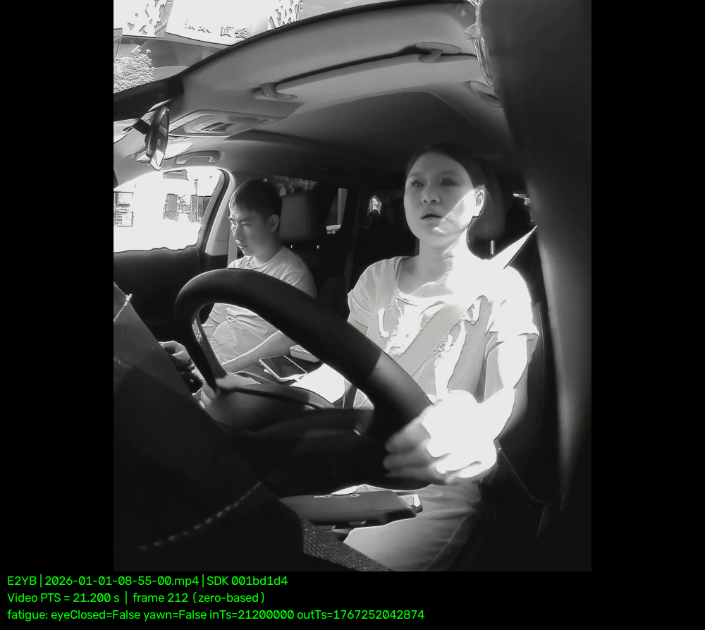

# E2YB 哈欠误报与漏检：内唇进入门限的 J6B 回灌验证

2026 年 1 月 1 日的两起现场反馈分别是微张口误报哈欠、真实哈欠未识别。两段录像使用同一台 J6B、E2YB 配置（car_type=3）和 5M 内参回灌。修改后，指定误报窗口的 30 个融合输出全部为 false；真实哈欠峰值仍有识别中断。以下结论覆盖 A 核疲劳融合输出，整车报警状态机和现场实装版本缺少对应日志。

## 两个事件如何定位

原片位于 `/mnt/d/dms_replay/`，均为 10 fps。误报对应 `2026-01-01-08-55-00.mp4`，现场时间 08:55:20.477，按现场同时提供的录像相对时间 21.161281 s 定位。驾驶员持续微张口，旧版回灌在 16.7–22.7 s 的 31 个有效输出均为 true。16.7 s 和 16.8 s 的外唇 MAR 分别达到 0.616、0.670；21.1 s 时仍为 0.538。外唇信号足以触发进入，随后又在滞回区间内维持。这个窗口的内唇开度为 0.119–0.332。

漏检对应 `2026-01-01-08-18-00.mp4`，按文件名起录时刻将现场 08:18:56.569 定位到约 56.569 s，连续画面确认主驾从约 54.5 s 开始明显张口。56.6 s 的原始 MAR 为 0.876，内唇开度为 0.722，yaw 为 −11.528°，越过 −10° 下限后该帧送入滤波器的 MAR 为 0。旧版在原片 55.8–57.1 s 有 8 个连续有效输入被清零；按融合归属时刻观察，55.4–55.6 s 已有触发，峰值段中断，57.7 s 再次触发。

## 实现与职责边界

关键点采用 68 点图的一基编号。内唇开度取中央内唇 63–67 的距离除以外嘴角 49–55 的距离。E2YB 进入哈欠须同时满足滤波后外唇 MAR ≥ 0.60、对应帧内唇开度 ≥ 0.40。进入许可与该帧 MAR 同时入队，以便 20 样本滑窗和两帧延时使用正确的帧。已进入后仍按原 MAR ≤ 0.40 退出。其他车型默认沿用原进入判据。

实现位于代码仓的 `fatigue_algorithm.cpp`、`post_kernel.cpp` 及对应头文件，车型门限位于 `etc/fatigue_params.json`。本次保留原头姿门控。**yaw 越界留给头姿模块重新标定**；标定后需同时复核本例真实哈欠峰值和既有偏头误报约束。历史背景见 [[02_Projects/DMS/05_Postprocess/2026-05-07_哈欠检测头部偏转误报兜底记录]]。

## 板端验证与截图

按原片 PTS 使用 08:55 的 5.0–30.0 s 和 08:18 的 40.0–59.2 s 两段输入。下表按融合归属时间统计，分子是 is_yawn=true 的输出数，分母是窗口内有效输出数。

| 录像及窗口 | 修改前板端 | 原输入离线预测（0.40） | 修改后重新跑模型 |
|---|---:|---:|---:|
| 08:55，16.7–22.7 s | 31/31 | 0/31 | 0/30 |
| 08:18，55.4–58.9 s | 9/19 | 9/19 | 11/19 |

完整模型链路异步采样，两轮的滤波历史会有差异。漏检窗口两轮共有 11 个融合时间戳，其中 57.3 s 和 58.9 s 的输出不同。用新一轮实际输入离线复算，两片分别与板端 105/105、101/101 个有效输出一致。再将原基线原子结果固定送入新 SDK，分别有 107/107、98/98 个有效输出的判定及融合归属时间与原离线结果一致。误报结论仅覆盖指定窗口。[完整录像逐帧对照](E2YB-yawn-20261112/frame-comparison.csv) · [固定输入逐帧对照](E2YB-yawn-20261112/fixed-input-comparison.csv)

下图取离误报标记最近的原片帧（零基帧 212，PTS 21.200 s，相差约 39 ms）。服务器 `dms_viewer` 环境使用仓库 `python_zmq/dms_viewer.py` 根据回灌 JPEG 与日志离屏渲染。图中 `yawn=False` 对应 `fatigue_fuse_result.is_yawn=false`。按融合的 `input_timestamp=21200000` µs 选图，产生此输出的原子帧为 21.700 s。原始记录为板端 `inner040/log55/J6x_DMS.log.20260101072037306` 第 11440 行。

板端证据根目录为 `/alglog/e2yb-yawn-TgCk2T/`。新版本完整录像日志在 `inner040/log55`、`inner040/log18`，固定输入日志在 `inner040/exact55`、`inner040/exact18`。回灌后保留新 SDK（MD5 为 `53b30bfcb5ad8d85bbb9597ac699a16b`）及 E2YB 疲劳配置（MD5 为 `a743392033aa64ca97f87f81a7bfc01f`）。旧 SDK 和疲劳配置备份在 `inner040/rollback/`，临时回灌及日志配置已恢复并核对摘要。

两份逐帧附件的 SHA-256 分别为 `52293692d7d7a2373d255138bfab107371ea0e8bed1ee94bf01ac5de033f476d`（完整录像）和 `e318494094a67f3174bc5d929d69aa79f252812ccb26ca651ed6684958b7957e`（固定输入）。
