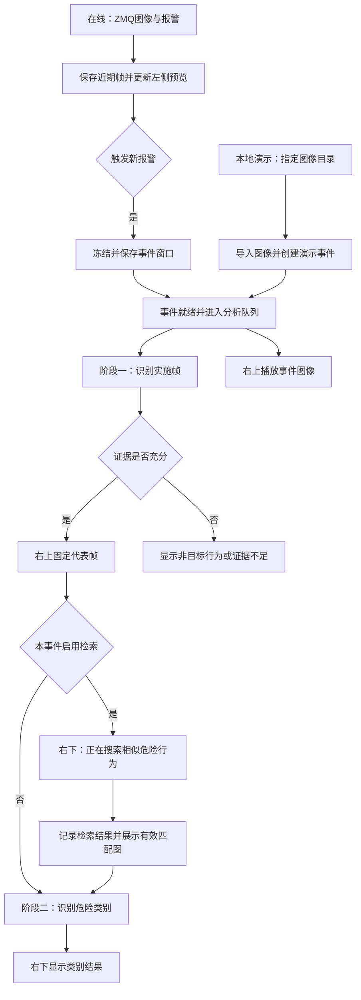

# 1 哨兵 AGENT 实现方案

本方案将 [[02_Projects/哨兵AGENT/哨兵AGENT方案]] 中的行为识别流程落实为两种运行模式：本地演示模式从指定目录直接创建分析事件，在线分析模式持续接收 ZMQ 图像并在哨兵报警时保存历史窗口。两种模式共用事件分析流程，依次识别实施帧和危险类别，前端展示输入图像、事件回放与分析结果。

当前尚无危险行为参考数据库，默认采用事件图像内的两阶段判断。建立参考库并显式启用检索后，在实施帧识别完成与类别识别之间加入相似行为检索，UI 同步显示搜索进度和匹配图像。本文记录设计与验收要求，尚未完成代码实现、接口联调或模型效果验证；本轮范围扩展的前后约定见 [[#1.8 修订记录]]。

## 1.1 两种模式如何进入同一分析流程

本地演示用于在没有实时发送端或报警信号时验证推理与 UI；在线分析用于接入真实图像流。两者只在事件创建方式和左侧图像来源上有所区别，实施帧识别、类别识别、错误处理和结果保存使用同一流程。

| 模式 | 输入与触发方式 | 左侧图像区域 |
|---|---|---|
| 本地演示 `local_demo` | 从配置的本地目录读取一次事件的图像，启动演示后直接提交分析，无需报警信号 | 按序播放本次导入图像，标注“本地演示” |
| 在线分析 `online` | 接收 ZMQ 连续帧，哨兵报警后冻结对应历史窗口并提交分析 | 持续显示最新接收帧，标注“实时画面” |

本地演示模式通过 `demo_input_path` 指定后端可读取的图像目录，一次导入作为一个事件；多段独立行为分别导入。优先采用随数据提供的时间与顺序清单，无清单时按文件名自然排序，并为每张图生成稳定帧 ID。只有顺序信息时明确标记为演示顺序，避免将文件修改时间当作采集时间。无法读取、目录为空或图像损坏时显示输入错误，并停止本次提交。

导入时将图像复制到独立事件目录，形成完整清单后直接进入分析队列。演示从导入完成状态直接启动推理，ZMQ 接收与报警等待仅在线模式启用。目录中的图像完整保存到演示事件，后续按 API 图像预算选取候选帧。原始演示目录不参与缓存清理。用户重新启动一次演示会创建新事件，单纯循环播放图像不重复调用 API。

在线模式平时处理连续帧，报警后处理边界固定的事件。图像接收与 API 分析速度不同，因此后端采用独立接收任务、缓存管理任务和分析 worker；UI 根据后端事件状态更新进度。



图中的检索分支适用于参考库已准备好的扩展配置；无匹配、检索失败的处理见 1.4.2。第一版采用在线单摄像头、一个分析 worker 顺序处理，运行模式在启动时选择。分析队列设容量上限；在线预览只消费最新帧，事件保存独立执行，等待模型期间仍能接收新画面。

## 1.2 接收接口与图像保存

本节适用于在线分析模式。ZMQ 的地址、连接方向和 socket 类型需要与发送端共同约定。接收端绑定本机地址时使用 bind；发送端已经绑定地址时，接收端按约定 connect。这里的“监听 IP”应落实为本地绑定地址或远端连接地址，避免混淆部署关系。

建议采用 multipart 消息：一部分为 JSON 元数据，另一部分为 JPEG/PNG 图像字节。下面是拟定的字段契约，实际解析器应适配发送端已有格式。

| 字段 | 用途 |
|---|---|
| schema_version | 标识消息格式版本 |
| camera_id | 区分图像来源 |
| frame_id | 唯一标识帧，与报警及模型返回结果关联 |
| capture_timestamp | 记录采集时间；双方统一单位与时基 |
| image_encoding | 指定 JPEG 或 PNG 等编码 |
| alarm_triggered | 标识当前消息是否触发报警 |
| event_id | 报警事件标识，用于去重；缺失时由接收端生成 |

接收端同时记录本地接收时间，用于检查延迟和连接状态。图像解析时校验编码、尺寸、消息长度及解码结果，异常消息记录原因并跳过。含图像和报警的同一消息，应先将该帧纳入事件可选范围，再执行窗口冻结。

普通帧保存到近期缓存，采用唯一文件名。写入临时文件成功后原子重命名，缓存索引只发布已经写完的文件。缓存按时间淘汰，并设置磁盘容量上限；不要反复覆盖固定文件名来实现轮换。

为降低报警信号丢失的风险，接口设计应包含报警确认、发送端重试及接收端去重。若既有发送端仅提供 PUB/SUB，可另设报警确认通道；最终模式以联调协议为准。普通帧在过载时可按明确策略采样或丢弃，同时记录丢帧数量。

## 1.3 报警窗口如何保留下来

在线报警由状态机计时触发，实施动作可能发生在报警之前。因此保护对象是关联的历史时间窗口，而非仅报警瞬间的一张图。本地演示直接保留已导入的图像集合，并复用本节的独立事件目录、完整性检查与保留规则。

设报警时间为 t，回看长度为 T_pre，可选后续采集长度为 T_post，则事件目标窗口为 `[t − T_pre, t + T_post]`。T_pre 应覆盖危险计时过程和延迟余量；若状态机跨间断累计，应优先根据实际参与计时的时间段确定窗口。图像与报警必须使用可对齐的时间基准。

第一版采用独立事件目录复制图像，目录结构如下：

```text
runtime/
  cache/<camera_id>/<frame_id>.jpg
  events/<event_id>/
    frames/<frame_id>.jpg
    manifest.json
    selection.json
    retrieval.json     # 仅启用检索时生成
    result.json
```

处理报警时，在缓存索引锁保护下选出帧清单，并将这些帧标记为暂时保留，然后释放索引锁执行复制。清理任务跳过受保护帧，接收任务继续写入新图像。若需要后续帧，则收集到截止时间后完成事件窗口。

复制完成后检查文件可读性和清单完整性，原子保存 manifest，并将事件标记为 ready。只有 ready 事件才能进入分析队列，随后解除原缓存帧的保护。复制失败、磁盘不足或历史窗口缺失时，应记录失败或缺失范围；失败分支也要释放临时保护，避免缓存无法回收。

manifest 保存事件 ID、输入模式 `source_mode`、触发来源、帧 ID 和事件内相对路径。在线事件额外保存摄像头、报警时间、期望与实际窗口及采集时间；演示事件保存导入时间、源目录和排序依据，缺失的采集时间与报警时间记为空。事件目录使用独立保留期限，正在保存、排队或分析的事件不参与自动清理。

复制是本版默认方案。后续若采用硬链接节省空间，需要确保文件内容不可修改、缓存只删除路径，并验证文件系统支持；符号链接不作为保护报警图像的手段。

## 1.4 两阶段调用如何衔接

两种模式的事件保存完成并标记为 ready 后，worker 从事件目录读取图像。先按时间覆盖（演示缺少采集时间时按帧顺序）、清晰度和目标可见性选择候选帧，保留动作前后变化；初始可沿用总体方案的每事件 6～12 帧建议，再用实际动作时长与 token 预算调整。

### 1.4.1 识别危险行为实施帧

第一阶段输入按时间或演示顺序排列的候选图，并提供帧 ID 和可用的时间信息，要求模型定位可见行为证据。返回结果至少包括：

- status：找到实施帧、未见目标行为或证据不足。
- representative_frame_id：供 UI 固定展示的一张代表帧。
- evidence_frame_ids：支持判断的帧集合，必要时包括前后邻帧。
- reason：可见依据或无法判断的原因。

后端校验返回 ID 属于本次提交的帧集合，并且对应文件存在。找到有效证据后保存 selection.json，将代表帧交给 UI，再按本事件配置执行可选检索或直接进入第二阶段。未见目标行为或证据不足时直接输出对应结果，避免无依据地继续分类。

### 1.4.2 可选的相似危险行为检索

检索是否启用由 `retrieval_enabled` 控制，与输入模式分别配置，默认关闭；本地演示也可以在准备好参考库后复用此分支。当前无参考库时，两种模式均直接进入类别识别。显式启用检索时，启动前检查参考库、向量索引、对应 Embedding 配置及图像路径，未就绪则提示配置错误。

在线模式进入检索后，右上继续固定本事件代表帧，右下先显示“正在搜索相似危险行为”。后端以本事件的代表帧及必要证据帧为查询，按总体方案约定生成向量、召回并筛选参考图，保存 `retrieval.json`。记录包括检索状态、参考图 ID、匹配分数、标签、图像引用、索引版本和耗时；第一版每个事件只执行一轮检索。

找到有效匹配后，后端发布带参考图引用的类别分析状态。右下展示匹配图像并标注“相似行为参考图”，同时显示“正在分析危险行为类别”；多张匹配图可展示最佳匹配并提供其他图片的切换入口。参考图需先校验可读并绑定到当前事件，避免显示上一个事件的图片。参考图只提供判别上下文，当前事件的实施证据始终来自右上对应的查询帧。

没有达到匹配条件的参考图时，保存“无匹配”结果，右下说明“未找到相似危险行为，将基于事件图像分析”，再进入无参考图的类别识别。检索超时或服务异常时记录处理失败，保留已选实施帧并提供检索重试入口；不将检索异常混同于无匹配，也不展示旧参考图继续分析。

### 1.4.3 识别危险行为类别

第二阶段使用代表帧、必要邻帧和总体方案中的九类标签定义。检索得到参考图时，将其图像与标签一起作为对照输入，并明确区分事件帧 ID 与参考图 ID；未启用检索或没有匹配时，仅使用事件图像。UI 在右上固定显示代表帧，右下在有匹配时展示参考图和类别分析进度。模型仍可观察动作过程，以区分踢、刮、手掰等行为。

结果包含 status、labels、evidence_frame_ids、observed_action、target_part、intent_status 和简短 reason。类别必须来自预定义集合，证据帧必须属于本次提交的事件帧集合，不能将参考图 ID 填入 evidence_frame_ids。后端完成结构校验后保存 result.json，并推送完成状态。

九类标签及部位边界沿用总体方案。无法确认时保留 non_target、other_dangerous 或 insufficient_evidence；请求超时、解析失败等记为 processing_failed。恶意拔枪还需要授权与充电状态，当前输入缺少这类信息时可描述疑似拔枪动作，并将意图保留为 unknown。

### 1.4.4 调用配置与费用记录

服务配置首先确定 `mode`（`local_demo` 或 `online`）、演示目录及顺序清单、是否启用检索和参考库位置；在线模式补充 ZMQ 与缓存窗口配置。千问调用配置包含 API 的 base_url、地域或工作空间、模型名、请求超时、重试次数、输入图像预算与输出限制。密钥由后端环境变量或受控配置读取；文档、代码仓库、日志和前端均不保存真实密钥。

两阶段独立记录模型与提示词版本、输入帧清单、耗时和 usage；启用检索时，额外记录查询 Embedding 与参考图输入的用量、检索状态和耗时。第一阶段已完成而第二阶段失败时，可以保留选帧结果并重试分类。每次尝试携带 attempt_id，迟到的旧请求结果不得覆盖较新的处理结果。

关闭检索时，费用结构为“选帧调用＋进入分类阶段的调用”。设进入第二阶段的比例为 p，则平均费用为 `C_event = C_selection + p × C_classification`，另计失败重试。未启用检索时，成功完成两阶段的事件通常消耗两次调用，没有建库与 Embedding 开销。启用检索时，另加实际执行的查询 Embedding 费用，并将参考图输入计入分类费用；参考库首次建库独立计费。两种输入模式均按实际推理调用计费，本地演示只是替换图像来源。总体方案中的检索复判比例和旧单事件预算不能直接用于本版，实际报价与首批 usage 确认后再估算金额。

## 1.5 三分区 UI 与后端状态

页面保持左半幅、右上、右下三个区域。左侧显示当前模式的输入画面：在线模式持续显示最新图像及连接状态，本地演示模式按序播放导入图像并显示文件名或帧序号。右上展示当前事件回放和选中的实施帧，右下展示检索参考图、分析进度与类别结果。

| 事件阶段 | 右上图像区域 | 右下信息区域 |
|---|---|---|
| 等待输入 | 在线提示等待报警；演示提示选择目录并启动 | 在线显示“等待哨兵报警”；演示显示“等待启动本地演示” |
| 保存或导入 | 显示保存进度或已就绪图像 | 在线显示“正在保存报警图像”；演示显示“正在读取演示图像” |
| 排队 | 可播放该事件回放 | 等待分析，并显示队列位置 |
| 实施帧识别 | 播放本地事件图像，并显示“正在解析危险行为实施帧” | 显示当前事件来源与时间或帧序号 |
| 相似行为检索（启用时） | 固定显示代表实施帧 | “正在搜索相似危险行为”，清空上一次事件的参考图 |
| 类别识别（有匹配） | 保持代表实施帧 | 展示匹配参考图，并显示“正在分析危险行为类别” |
| 类别识别（关闭检索或无匹配） | 保持代表实施帧 | “正在分析危险行为类别”；无匹配时附上检索结果说明 |
| 完成 | 保留代表帧及其时间或帧序号 | 保留有效参考图，显示类别提示和简短依据 |
| 非目标行为或证据不足 | 保留事件回放或已选图像 | 分别显示“未发现目标危险行为”或“当前图像不足以确认危险行为” |
| 处理失败 | 保留可用事件图像 | 显示失败阶段、原因和重试入口 |

右上根据来源标注“报警回放”或“演示回放”。后端完成第一阶段时，前端取消回放定时器，立即固定代表帧。后端随后进入检索或类别识别，无需等待回放结束；右下的参考图不会替换右上的实施帧。

类别确认后按“注意，您的爱车可能被{行为描述}”展示。例如标签为“踢车门”时显示“注意，您的爱车可能被踢踹，疑似接触部位：车门”；“刮车身”对应“注意，您的爱车可能被刮擦，疑似接触部位：车身”。九类标签使用预设提示映射，补充具体部位与动作描述，保持语句通顺。非目标行为、其他危险行为、证据不足和调用失败使用对应状态提示，只有确认目标类别后才展示该报警模板；本地演示结果附“演示数据”标识。

后端可用 WebSocket 推送输入帧引用、事件状态及结果。状态消息包含 source_mode、event_id、attempt_id、递增序号和阶段；进入类别识别时附检索状态及有效参考图引用，完成时附类别与提示文本。前端只应用属于当前事件且序号更新的状态。即使搜索与分类很快完成，匹配图引用也随类别状态传递，避免依赖上一条消息才能显示。

页面重新连接时，先请求事件快照再接收增量更新，快照包含当前阶段、代表帧和参考图。在线图像中断时保留最后一帧，并显示“连接中断”及最后更新时间；本地演示播放结束时显示“演示播放结束”，不将其当作连接故障或再次触发分析。

## 1.6 连续报警、容量与恢复

在线模式下，发送端若能提供稳定的 event_id，后端直接据此去重。只有持续为真的报警标志时，可采用上升沿创建事件，并约定报警解除与再次触发的规则；该规则需要结合实际状态机确认，避免把持续报警拆成大量请求。

本地演示由每次启动操作创建独立事件，页面重连和图像循环播放均不重新提交。两种模式创建的新事件使用独立目录并进入队列。第一版右侧保持当前事件，提示新增待处理事件，并允许切换；旧事件结果更新其自身记录，不覆盖用户正在查看的新事件。

分析队列有上限。队列满时，已保存事件标记为待处理并在容量释放后调度，同时限制待处理事件总数和磁盘占用。磁盘达到上限时明确返回容量不足，记录未能完整保存的事件；实时预览和分析错误分别上报。

manifest 及状态持久化后，进程重启可发现未完成事件。恢复时重新校验文件，明确选择继续分析或显示中断，不将中断状态当作成功。恢复可能再次产生 API 费用，因此记录每次调用尝试和结果提交情况。

## 1.7 开发顺序与验收

先用指定目录完成本地演示事件导入、两阶段模型调用与三分区展示，确认没有报警输入也能完整运行；再接入真实 ZMQ 消息，验证时间戳、报警触发和窗口轮换。参考库就绪后启用检索分支，核对搜索状态、参考图展示与类别结果的顺序。这样能先验证共用分析流程，再验证在线接入和可选检索。

| 验收场景 | 预期结果 |
|---|---|
| 本地演示指定有效目录，未连接发送端也没有报警 | 导入成功后直接调用实施帧识别和类别识别，三分区展示演示数据 |
| 演示目录为空、无权限或图像损坏 | 报告输入错误，不提交不完整事件，不修改源目录 |
| 本地演示播放结束、循环播放或页面重连 | 不重复调用 API，结果仍归属原事件 |
| 持续输入并超过缓存窗口 | 近期缓存按规则轮换，实时预览持续更新 |
| 报警后继续大量输入 | 事件目录帧清单和图像内容保持稳定 |
| 保存与清理同时发生 | 已选帧受保护，分析只能读取完整的 ready 事件 |
| 第一阶段返回有效帧 ID | 右上固定对应图像，随后按配置进入检索或类别识别 |
| 在线事件启用检索且命中有效参考图 | 右下先显示“正在搜索相似危险行为”，命中后展示参考图及“正在分析危险行为类别”，API 返回后显示“注意，您的爱车可能被{行为描述}” |
| 检索关闭或索引未配置 | 关闭时直接分类；显式启用但索引未就绪时提示配置错误 |
| 检索正常完成但无匹配 | 记录无匹配，明确说明后仅用事件图像分类，不展示旧参考图 |
| 检索超时或失败 | 保留实施帧，显示检索失败及重试入口 |
| 类别结果引用参考图作为证据 | 拒绝无效 evidence_frame_ids，保持查询事件与参考图的来源区分 |
| 返回未知帧 ID或无效标签 | 后端拒绝无效结果并记录处理失败 |
| 未找到明确实施帧 | 显示证据不足或非目标行为，不强制输出危险类别 |
| 同一报警重复发送 | 只创建一个事件，避免重复提交分析 |
| 两个事件先后到来、旧请求迟到 | 每个结果归属正确，UI 不发生跨事件覆盖 |
| API 超时、队列满或磁盘不足 | 错误状态明确，已保存证据可追溯 |
| 进程或页面重启 | 根据持久化事件与快照恢复可解释的状态 |

以上是计划验收项。分类效果仍需用真实危险事件和正常行为分别评测，报告逐类准确性、误报与拒判、端到端延迟和实际费用。

进入编码前先确定演示目录的图像格式、排序与时间清单约定、千问服务地址与模型名。在线联调时补齐 ZMQ 消息样例、socket 类型与连接方向、时间戳单位与时钟关系、图像频率与尺寸、报警计时规则和缓存窗口；启用检索前确认参考库、索引版本、匹配条件和参考图展示数量。事件保留期限、队列与磁盘容量在两种模式下共用。单摄像头、单 worker 和复制事件图像是建议初始配置，其余数值通过接口约定与联调确定。

## 1.8 修订记录

2026-11-04 根据用户提出的双模式与在线检索展示建议，扩展原 2026-11-01 设计。原文范围为“无参考数据库阶段的ZMQ图像接收、报警事件保存、两阶段千问识别与三分区UI”，第一阶段完成后直接进入类别识别；该约定继续作为在线、关闭检索时的默认分支。

本轮以 [[#1.1 两种模式如何进入同一分析流程]] 扩展输入入口，以 [[#1.4.2 可选的相似危险行为检索]] 和 [[#1.5 三分区 UI 与后端状态]] 补充开启检索后的流程与展示顺序，接替原先只描述单一路径的范围约定。修订依据为用户本轮需求及总体方案的可配置检索设计；仅更新设计和计划验收项，代码、API 和 UI 均尚未验证。
