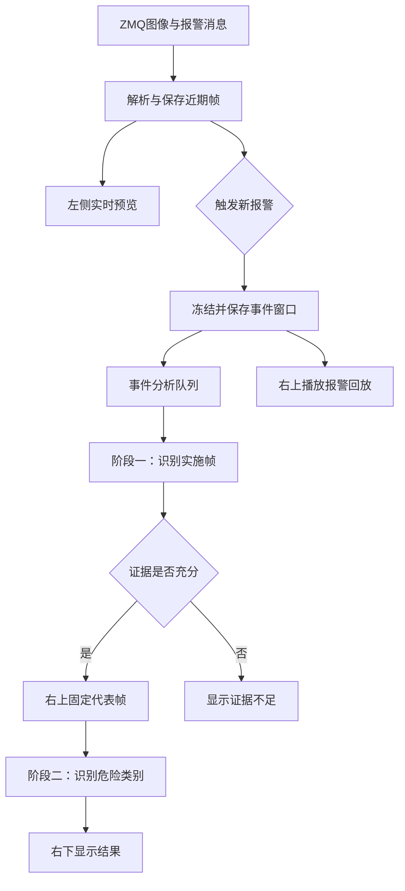

# 1 哨兵 AGENT 实现方案

本方案将 [[02_Projects/哨兵AGENT/哨兵AGENT方案]] 中的行为识别流程落实为第一版可开发系统：后端持续接收 ZMQ 图像消息，在哨兵报警时保存关联的历史窗口，再依次调用千问模型识别实施帧和危险类别，前端同步展示实时画面、报警回放与分析结果。

当前尚无危险行为参考数据库，因此本版先完成事件图像内的两阶段判断。后续建立参考库后，再接入特征提取、相似样本比对和参考图复核。本文记录设计与验收要求，尚未完成代码实现、接口联调或模型效果验证。

## 1.1 从连续图像到独立报警事件

系统平时处理连续帧，报警后处理一个有固定边界的事件。两者的速度不同：图像必须持续接收，API 分析可以排队执行。因此后端采用独立接收任务、缓存管理任务和分析 worker；UI 通过后端状态获取进度。



第一版按单摄像头、一个分析 worker 顺序处理实现。队列有容量上限，实时预览只消费最新帧；事件保存则独立执行，确保等待模型期间仍能接收新画面。

## 1.2 接收接口与图像保存

ZMQ 的地址、连接方向和 socket 类型需要与发送端共同约定。接收端绑定本机地址时使用 bind；发送端已经绑定地址时，接收端按约定 connect。这里的“监听 IP”应落实为本地绑定地址或远端连接地址，避免混淆部署关系。

建议采用 multipart 消息：一部分为 JSON 元数据，另一部分为 JPEG/PNG 图像字节。下面是拟定的字段契约，实际解析器应适配发送端已有格式。

| 字段 | 用途 |
|---|---|
| schema_version | 标识消息格式版本 |
| camera_id | 区分图像来源 |
| frame_id | 唯一标识帧，与报警及模型返回结果关联 |
| capture_timestamp | 记录采集时间；双方统一单位与时基 |
| image_encoding | 指定 JPEG 或 PNG 等编码 |
| alarm_triggered | 标识当前消息是否触发报警 |
| event_id | 报警事件标识，用于去重；缺失时由接收端生成 |

接收端同时记录本地接收时间，用于检查延迟和连接状态。图像解析时校验编码、尺寸、消息长度及解码结果，异常消息记录原因并跳过。含图像和报警的同一消息，应先将该帧纳入事件可选范围，再执行窗口冻结。

普通帧保存到近期缓存，采用唯一文件名。写入临时文件成功后原子重命名，缓存索引只发布已经写完的文件。缓存按时间淘汰，并设置磁盘容量上限；不要反复覆盖固定文件名来实现轮换。

为降低报警信号丢失的风险，接口设计应包含报警确认、发送端重试及接收端去重。若既有发送端仅提供 PUB/SUB，可另设报警确认通道；最终模式以联调协议为准。普通帧在过载时可按明确策略采样或丢弃，同时记录丢帧数量。

## 1.3 报警窗口如何保留下来

报警由状态机计时触发，实施动作可能发生在报警之前。因此保护对象是关联的历史时间窗口，而非仅报警瞬间的一张图。

设报警时间为 t，回看长度为 T_pre，可选后续采集长度为 T_post，则事件目标窗口为 `[t − T_pre, t + T_post]`。T_pre 应覆盖危险计时过程和延迟余量；若状态机跨间断累计，应优先根据实际参与计时的时间段确定窗口。图像与报警必须使用可对齐的时间基准。

第一版采用独立事件目录复制图像，目录结构如下：

```text
runtime/
  cache/<camera_id>/<frame_id>.jpg
  events/<event_id>/
    frames/<frame_id>.jpg
    manifest.json
    selection.json
    result.json
```

处理报警时，在缓存索引锁保护下选出帧清单，并将这些帧标记为暂时保留，然后释放索引锁执行复制。清理任务跳过受保护帧，接收任务继续写入新图像。若需要后续帧，则收集到截止时间后完成事件窗口。

复制完成后检查文件可读性和清单完整性，原子保存 manifest，并将事件标记为 ready。只有 ready 事件才能进入分析队列，随后解除原缓存帧的保护。复制失败、磁盘不足或历史窗口缺失时，应记录失败或缺失范围；失败分支也要释放临时保护，避免缓存无法回收。

manifest 保存事件 ID、摄像头 ID、报警时间、期望与实际窗口、帧 ID、采集时间及事件内相对路径。事件目录使用独立保留期限，正在保存、排队或分析的事件不参与自动清理。

复制是本版默认方案。后续若采用硬链接节省空间，需要确保文件内容不可修改、缓存只删除路径，并验证文件系统支持；符号链接不作为保护报警图像的手段。

## 1.4 两阶段调用如何衔接

完成事件保存后，worker 从事件目录读取图像。先按时间覆盖、清晰度和目标可见性选择候选帧，保留动作前后变化；初始可沿用总体方案的每事件 6～12 帧建议，再用实际动作时长与 token 预算调整。

### 1.4.1 识别危险行为实施帧

第一阶段输入按时间排列的候选图、明确的帧 ID 和时间信息，要求模型定位可见行为证据。返回结果至少包括：

- status：找到实施帧、未见目标行为或证据不足。
- representative_frame_id：供 UI 固定展示的一张代表帧。
- evidence_frame_ids：支持判断的帧集合，必要时包括前后邻帧。
- reason：可见依据或无法判断的原因。

后端校验返回 ID 属于本次提交的帧集合，并且对应文件存在。找到有效证据后保存 selection.json，将代表帧交给 UI，再进入第二阶段。未见目标行为或证据不足时直接输出对应结果，避免无依据地继续分类。

### 1.4.2 识别危险行为类别

第二阶段使用代表帧、必要邻帧和总体方案中的九类标签定义。UI 固定显示代表帧，模型仍可观察动作过程，以区分踢、刮、手掰等行为。

结果包含 status、labels、evidence_frame_ids、observed_action、target_part、intent_status 和简短 reason。类别必须来自预定义集合，证据帧必须属于本次输入。后端完成结构校验后保存 result.json，并推送完成状态。

九类标签及部位边界沿用总体方案。无法确认时保留 non_target、other_dangerous 或 insufficient_evidence；请求超时、解析失败等记为 processing_failed。恶意拔枪还需要授权与充电状态，当前输入缺少这类信息时可描述疑似拔枪动作，并将意图保留为 unknown。

### 1.4.3 调用配置与费用记录

服务配置包含千问 API 的 base_url、地域或工作空间、模型名、请求超时、重试次数、输入图像预算与输出限制。密钥由后端环境变量或受控配置读取；文档、代码仓库、日志和前端均不保存真实密钥。

两阶段独立记录模型与提示词版本、输入帧清单、耗时和 usage。第一阶段已完成而第二阶段失败时，可以保留选帧结果并重试分类。每次尝试携带 attempt_id，迟到的旧请求结果不得覆盖较新的处理结果。

本版的费用结构为“选帧调用＋进入分类阶段的调用”。设进入第二阶段的比例为 p，则平均费用为 `C_event = C_selection + p × C_classification`，另计失败重试。成功完成两阶段的事件通常消耗两次调用；当前没有建库与 Embedding 开销。总体方案中的检索复判比例和旧单事件预算不能直接用于本版，实际报价与首批 usage 确认后再估算金额。

## 1.5 三分区 UI 与后端状态

左侧占页面宽度的一半，持续显示最新图像，附摄像头、采集时间和连接状态。右侧上半部分展示当前选中报警事件的图像，下半部分展示分析进度和类别结果。

| 事件阶段 | 右上图像区域 | 右下信息区域 |
|---|---|---|
| 等待报警 | 提示等待报警事件 | 等待哨兵报警 |
| 保存窗口 | 显示保存进度或已保存帧 | 正在保存报警图像 |
| 排队 | 可播放该事件回放 | 等待分析，并显示队列位置 |
| 实施帧识别 | 播放本地事件图像，并显示“正在解析危险行为实施帧” | 显示当前事件时间 |
| 类别识别 | 停止回放，固定显示代表实施帧 | 正在分析危险行为类别 |
| 完成 | 保留代表帧及其时间 | 显示类别提示和简短依据 |
| 证据不足 | 保留事件回放或已选图像 | 当前图像不足以确认危险行为 |
| 处理失败 | 保留可用事件图像 | 显示失败原因和重试入口 |

右上明确标注“报警回放”，避免与左侧实时画面混淆。后端完成第一阶段时，前端取消该事件的回放定时器，立即切换到代表帧；第二阶段由后端继续执行，无需等待回放结束。

类别提示使用确定的文本模板，例如“注意，您的爱车可能遭到踢踹，疑似接触部位：车门”。非目标行为、其他危险行为和证据不足采用各自提示；调用失败与未发现危险行为分别呈现。

后端可用 WebSocket 向页面推送最新帧引用、事件状态及结果。状态消息包含 event_id、attempt_id 和递增序号，UI 只将匹配当前事件且更新的状态应用到右侧区域。页面重新连接时，先请求事件快照再接收增量更新。左侧图像中断时保留最后一帧，并明确显示“连接中断”及最后更新时间。

## 1.6 连续报警、容量与恢复

发送端若能提供稳定的 event_id，后端直接据此去重。只有持续为真的报警标志时，可采用上升沿创建事件，并约定报警解除与再次触发的规则；该规则需要结合实际状态机确认，避免把持续报警拆成大量请求。

新事件到来后创建独立目录并进入队列。第一版右侧保持当前事件，提示新增待处理事件，并允许切换；旧事件结果更新其自身记录，不覆盖用户正在查看的新事件。

分析队列有上限。队列满时，已保存事件标记为待处理并在容量释放后调度，同时限制待处理事件总数和磁盘占用。磁盘达到上限时明确返回容量不足，记录未能完整保存的事件；实时预览和分析错误分别上报。

manifest 及状态持久化后，进程重启可发现未完成事件。恢复时重新校验文件，明确选择继续分析或显示中断，不将中断状态当作成功。恢复可能再次产生 API 费用，因此记录每次调用尝试和结果提交情况。

## 1.7 开发顺序与验收

先接入一条真实 ZMQ 消息，验证图像、时间戳和报警字段；再实现窗口保存和回放，最后接入两阶段模型与 UI 状态。这样每一步都有可独立检查的输入输出。

| 验收场景 | 预期结果 |
|---|---|
| 持续输入并超过缓存窗口 | 近期缓存按规则轮换，实时预览持续更新 |
| 报警后继续大量输入 | 事件目录帧清单和图像内容保持稳定 |
| 保存与清理同时发生 | 已选帧受保护，分析只能读取完整的 ready 事件 |
| 第一阶段返回有效帧 ID | 右上固定对应图像，第二阶段收到代表帧与必要邻帧 |
| 返回未知帧 ID或无效标签 | 后端拒绝无效结果并记录处理失败 |
| 未找到明确实施帧 | 显示证据不足或非目标行为，不强制输出危险类别 |
| 同一报警重复发送 | 只创建一个事件，避免重复提交分析 |
| 两个事件先后到来、旧请求迟到 | 每个结果归属正确，UI 不发生跨事件覆盖 |
| API 超时、队列满或磁盘不足 | 错误状态明确，已保存证据可追溯 |
| 进程或页面重启 | 根据持久化事件与快照恢复可解释的状态 |

以上是计划验收项。分类效果仍需用真实危险事件和正常行为分别评测，报告逐类准确性、误报与拒判、端到端延迟和实际费用。

进入编码前需要确定 ZMQ 消息样例、socket 类型与连接方向、时间戳单位与时钟关系、图像频率与尺寸、报警计时规则、回看及后续窗口、事件保留期限、队列和磁盘容量，以及千问服务地址与模型名。当前单摄像头、单 worker 和复制事件图像是建议初始配置，其余数值通过接口约定与联调确定。
