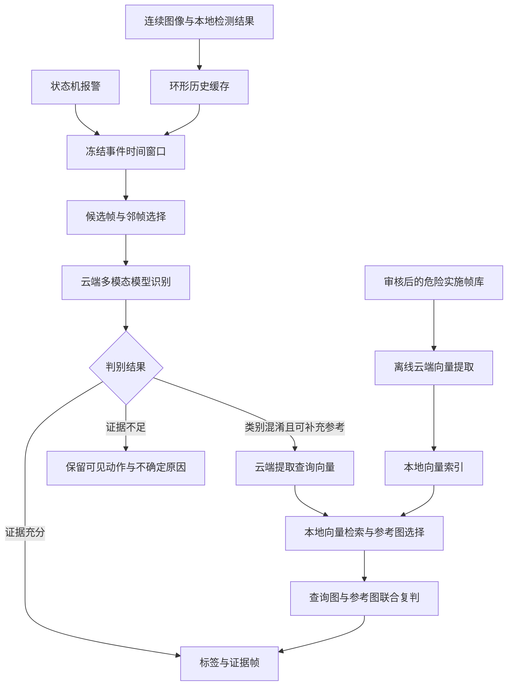

# 1 哨兵 AGENT 方案

本方案利用本地模型完成持续危险检测，在状态机报警后，通过云端多模态模型识别具体行为。系统保存事件时间窗口内的历史帧，从中组织动作证据；需要进一步区分类别时，再从危险行为参考库检索相似样本，辅助完成判别。

第一阶段以“历史窗口选帧＋云端识别”建立效果基线，随后验证图像检索带来的增益。供应商选择 Qwen 进行试点，模型版本、选帧参数和分类阈值通过项目数据确定。

## 1.1 目标与输入输出

### 1.1.1 目标标签

系统识别以下九类目标行为：

| 动作 | 目标部位 | 输出标签 |
|---|---|---|
| 踢 | 轮胎 | 踢轮胎 |
| 踢 | 车身其他区域 | 踢车身 |
| 踢 | 车门 | 踢车门 |
| 踢 | 保险杠 | 踢保险杠 |
| 刮 | 车门 | 刮车门 |
| 刮 | 车身其他区域 | 刮车身 |
| 脚踢 | 车牌 | 脚踢车牌 |
| 手掰 | 车牌 | 手掰车牌 |
| 拔出或强行拉拽，结合业务证据判定恶意 | 自车充电枪 | 恶意拔自车充电枪 |

内部采用“动作＋部位＋业务上下文”的表示，再映射到目标标签。车身其他区域指车门、保险杠、车牌等独立类别之外的车身区域，具体部位范围在标注规范中统一。部位不可见时保留“部位不确定”，便于后续复核。

“自车”通过摄像头与车辆绑定关系确认；“恶意拔枪”结合动作过程、授权状态、充电状态等业务证据判断。业务证据不足时，可以记录疑似拔枪动作，并将意图状态保留为未知。

### 1.1.2 输入约定

对外输入为连续到达的单帧图像和报警信号，由编排层积累成事件窗口：

- 图像携带帧 ID、采集时间戳和摄像头 ID。
- 本地检测结果保存原始标签。
- 报警携带事件触发时间和参与危险计时的时间段。

### 1.1.3 输出约定

输出包含目标标签及对应的查询事件证据帧。

事件状态包括：

| 状态                      | 含义                         |
| ----------------------- | -------------------------- |
| `classified`            | 已获得足够证据，输出目标标签             |
| `non_target`            | 证据支持正常行为或不属于目标范围的行为        |
| `other_dangerous`       | 存在危险行为，但不属于九类目标标签          |
| `insufficient_evidence` | 动作、部位或业务上下文不足以支持目标标签       |
| `processing_failed`     | 请求超时、服务异常或输出解析失败，等待重试或人工处理 |

业务判断状态与服务异常分开保存，便于统计真实识别效果。

## 1.2 总体流程



本地负责缓存、事件组织和检索，云端负责视觉特征提取及行为判别。初期通过固定流程编排即可完成任务，每个阶段保留输入、结果及版本信息，便于复现和定位问题。

检索增强作为可配置分支。先比较直接识别与检索增强的效果，再决定哪些类别需要检索，以及是否调整检索在流程中的位置。

## 1.3 数据准备与离线特征提取

### 1.3.1 数据分层

| 数据 | 内容 | 用途与保留方式 |
|---|---|---|
| 危险行为参考库 | 已确认的危险行为实施帧 | 长期保存，供检索使用 |
| 事件缓存 | 报警关联的历史帧、邻帧和检测结果 | 有限期保存，供事件分析使用 |
| 评测数据 | 危险事件、正常行为及易混淆事件 | 独立管理，供效果验证使用 |

参考库遵循“只包含危险行为实施帧”的要求。实施帧由完整事件上下文辅助确认，保存时附带动作、部位、来源事件。来自同一事件的大量相邻帧进行筛选，保持车型、视角、光照、遮挡和人员姿态的覆盖。

其他危险类别可作为类别对照，例如用“踢轮胎”辅助区分“踢车门”。正常开门、擦车、系鞋带、合法拔枪等样本放在独立评测数据中，用于衡量误报。若后续需要将正常行为作为在线参考，再单独设计正常行为参考集。

### 1.3.2 图像与向量记录

每张参考图保存：

- `image_id`、图像路径、图像 hash。
- 行为标签、动作、目标部位、来源事件 ID。
- 审核状态、可见性说明和裁剪区域。
- Embedding 模型、版本、向量维度、预处理配置和提取时间。

### 1.3.3 提取与索引

通过专用视觉 Embedding API 分批提取向量，使用限流队列、失败重试和断点续跑处理大规模图片。初期先处理审核过的小型参考集，验证收益后扩展到全量。

每张图生成独立向量，并将向量与元数据索引保存在本地。库图和在线查询图使用相同的模型版本、维度、预处理与归一化规则。通过“图像 hash＋模型版本＋预处理配置”识别可复用结果，减少重复调用。

模型或预处理升级时建立独立索引，验证通过后切换。向量存储容量可按“图像数量×每图视图数×向量维度×每元素字节数”估算，另加索引和元数据开销。

## 1.4 在线事件编排

### 1.4.1 历史窗口组织

环形缓存覆盖危险计时过程、前置上下文和处理延迟。报警后冻结对应事件窗口，允许按延迟预算补充少量后续帧，以观察动作结束状态。

状态机若采用间断累计计时，应记录参与累计的时间段，使窗口能够覆盖实际触发依据。同一事件的重复报警按事件 ID 或时间关联规则合并，减少重复识别。

### 1.4.2 候选帧选择

结合以下信息选择候选帧：

1. 事件窗口内的时间覆盖。
2. 图像清晰度、目标可见性和有效接触区域。

初始实验可采用每事件 6～12 张查询帧，再根据动作持续时间、采样率和延迟预算调整。去重以保留“接近—接触—离开”的动作变化为原则。逐帧分数不足时，采用时间均匀采样与危险标签邻域相结合的方式。

候选帧筛选关注证据覆盖率；实施帧由后续判别结合时序确认。

### 1.4.3 云端直接识别

将候选帧按时间顺序输入云端多模态模型，明确每张图的 ID 和时间戳。

提示词提供标签定义、部位边界和判断要求，要求模型返回：

- 可见动作与接触部位。
- 支持结论的查询帧 ID。
- 目标标签或未完成判定的原因。
- 业务上下文是否足以支持意图判断。

报警信号用于说明事件来源，识别结论以图像和业务证据为依据。模型返回的自评置信度可作为实验特征，生产判定阈值通过独立验证集校准。

### 1.4.4 检索增强与复判

当查询图像包含可用动作证据，但具体类别存在混淆时，对相关候选图提取向量，并在参考库中检索。

设查询图有 m 张，第 c 类参考图有 $x_c$张，向量维度为 d。归一化后的查询矩阵为 $Q∈R^(m×d)$，类别矩阵为 $D_c∈R^(x_c×d)$，余弦相似度矩阵为 $S_c=Q·D_cᵀ$。全库共有 $Σx_c$张参考图，完整相似度矩阵规模为 $m×Σx_c$。

实现时使用向量索引召回 Top-k，避免在线计算完整矩阵。参考图选择兼顾相似度、类别覆盖及来源事件多样性，减少重复帧和类别规模差异的影响。检索分数用于参考样本排序，最终标签由查询事件的证据确定。

首轮可从总计 2～4 张参考图开始试验，集中覆盖当前混淆类别。输入中显式区分查询帧和参考图，并附上参考图标签。复判只允许引用查询帧作为本次行为的证据。

复判后仍无法确认的事件保留不确定原因。初期每事件最多进行一轮检索增强，控制请求次数、费用和延迟。

### 1.4.5 结果与运行记录

输出示例：

```json
{
  "event_id": "evt_001",
  "status": "classified",
  "labels": ["踢车门"],
  "evidence_frame_ids": ["f103", "f104"],
  "observed_action": "踢",
  "target_part": "车门",
  "intent_status": "unknown",
  "reason": "连续帧显示脚向车门运动并在车门处接触"
}
```

运行记录额外保存模型与提示词版本、查询帧清单、参考图 ID、各阶段耗时、API usage、错误和重试情况。API 失败采用有界重试与事件幂等处理；超出预算后记录处理失败。新事件经审核确认实施帧后，再加入参考库。

## 1.5 API 选型与成本

### 1.5.1 选型目标与性能粗估

性能粗估围绕三个能力展开：识别人与车辆部件的接触关系、结合多帧理解动作过程、从参考图中检索相似行为。优先参考视觉感知、多模态推理与视频理解 benchmark，同时检查多图输入和独立图像向量接口。公开分数用于判断能力档位，不直接换算成九类危险行为的准确率。

| 候选 | 可用的公开性能证据 | 面向本项目的采购前判断 |
|---|---|---|
| Qwen3.8-Max | 初始发布报告：MMMU-Pro 82.3，BabyVision 无工具 82.0；官方 API 文档支持多图输入 | 视觉感知与推理证据较完整，适合作为首期效果优先的判别模型 |
| Qwen3-VL-Plus | 官方文档支持多图视觉理解；本次未取得与上述模型同口径的精确 API 版本分数 | 低成本备选；其性能依据单独记录，不沿用 Max 或开源权重模型的分数 |
| Kimi K3 | 官方仓库：MMMU-Pro 无工具 81.6，PerceptionBench 58.5，Video-MME 含字幕 90.0 | 具备较强视觉能力，可作后续替代候选；当前公开证据不足以证明它在本任务上优于 Qwen |
| DeepSeek Flash | 当前官方 API 支持图像理解；本次未取得对应版本可对齐的视觉 benchmark | 价格较低，保留为降本候选；性能不确定性单独标记 |

从任务匹配度粗估：接触点清晰的踢击与部位分类具有较好的实现基础；细小刮擦、手掰车牌、严重遮挡对图像质量和时序证据要求更高；恶意拔枪还依赖授权及充电状态。

### 1.5.2 采购建议与价格依据

**首期申请 Qwen3.8-Max 判别 API 与 Qwen3-VL-Embedding 向量 API**。选择依据是视觉能力公开证据、两类接口的完整性，以及下文可承受的首期验证费用。
Qwen3-VL-Plus 作为同平台降本备选。

| API                |        输入单价 |  输出单价 | 预算口径                            |
| ------------------ | ----------: | ----: | ------------------------------- |
| Qwen3.8-Max        |        12 元 |  36 元 | 输入不超过 1M；输出包含计费的思考过程            |
| Qwen3-VL-Plus      |         1 元 |  10 元 | 单次输入不超过 32K；超过后需采用对应阶梯价         |
| Qwen3-VL-Embedding | 图像/视频 1.8 元 |     — | 按图像输入 token 估算                  |
| DeepSeek Flash     |         2 元 |   8 元 | 高峰、缓存未命中；空闲时段价格减半               |
| Kimi K3            |        3 美元 | 15 美元 | 官方发布价，缓存未命中；人民币结算与当前缓存写入费用需单独确认 |

### 1.5.3 预算假设与单事件费用

参考库规模和报警量暂未确定，先给出可替换的预算参数。全部数值为申请阶段假设，不代表已测得的消耗。

| 参数 | 基准假设 | 含义 |
|---|---:|---|
| m | 8 张 | 每事件查询帧数量 |
| k | 4 张 | 复判额外提供的参考图数量 |
| T_v | 1,024 tokens/张 | 判别模型的平均图像 token 预算 |
| T_e | 1,024 tokens/张 | Embedding 平均图像 token 假设，独立于判别编码规则 |
| T_p | 1,000 tokens/请求 | 标签说明、时间戳、提示词等文本 |
| T_o | 2,048 tokens/请求 | 计费输出预算，包含思考过程与最终结果 |
| r | 25% | 在线事件进入检索复判分支的预计比例 |
| V | 1 | 每张库图提取的视图数 |
| b | 30% | 重试、调试及估算偏差预留 |

Qwen 视觉文档给出的图像 token 估算为“处理后高×宽÷1,024＋2”。例如处理后 1,024×1,024 图像约为 1,026 tokens，预算取近似值 1,024；实际需结合保持宽高比的缩放与像素上限计算。Embedding 的 T_e 暂作为独立规划假设。图像数量增加、裁剪视图增加或更高分辨率均应相应上调预算。

设判别输入、输出及 Embedding 单价分别为 P_in、P_out、P_e，费用单位为元：

```text
C_first = ((m × T_v + T_p) × P_in + T_o × P_out) / 1,000,000
C_query = m × T_e × P_e / 1,000,000
C_second = (((m + k) × T_v + T_p) × P_in + T_o × P_out) / 1,000,000
C_event = C_first + r × (C_query + C_second)
C_build = N × V × T_e × P_e / 1,000,000
```

代入 Qwen3.8-Max 与 Qwen3-VL-Embedding 的价格：

| 费用项 | 估算费用 |
|---|---:|
| 首轮识别 C_first | 0.1840 元/事件 |
| 查询帧向量 C_query | 0.0147 元/进入检索的事件 |
| 第二轮判别 C_second | 0.2332 元/进入复判的事件 |
| 按 25% 复判率计算的平均 C_event | **约 0.2460 元/事件** |
| 10 万张图、单视图首次建库 | **184.32 元** |

第二轮重新输入全部查询帧和参考图，不假设命中缓存。输出预算用于费用测算，接入时应设置相应输出与思考限制；若该预算不足以完成识别，则重新估算。

### 1.5.4 运行规模与经费区间

按“首次建库＋1 个月在线调用＋30% 预留”测算，便于规模明确后选择。

| 场景  | 参考库图片数 |  月事件量 |    一次性建库 |      月在线调用 |      含预留合计 |    预算取整 |
| --- | -----: | ----: | -------: | ---------: | ---------: | ------: |
| 小规模 |    1 万 | 1,000 |  18.43 元 |   246.01 元 |   343.78 元 |   400 元 |

## 1.6 API验证

| 实验 | 输入与流程 | 主要验证目标 |
|---|---|---|
| A：人工选帧 | 人工关键帧及邻帧→云端识别，危险事件包含实施帧 | 在证据较充分时检查分类能力 |
| B：自动选帧 | 事件窗口→自动选帧→云端识别 | 量化选帧造成的效果损失 |
| C：检索增强 | 自动选帧→直接识别→检索复判 | 对比检索前后的效果、费用与延迟 |

参考库、开发集和测试集按事件隔离，尽量按车辆或场景进一步分组。同一事件的相邻帧保持在同一分组。两轮配置评估应区分开发事件与保留测试事件，保留集用于最终验收，不参与提示词调优。

评测覆盖白天、夜间、遮挡、不同视角、小目标和多人场景；模型、提示词或索引升级后使用固定回归集复核。

验证报告记录实施帧 Recall@B、逐类 Precision/Recall、宏平均 F1、正常行为误报率、拒判率、已判定样本准确率，以及平均费用、P95 延迟和失败率。端到端漏检另需覆盖本地未报警的危险事件。恶意拔枪分别报告动作识别和业务上下文充分时的最终判断。


